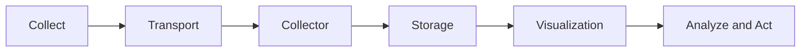

# adriannovegil/awesome-observability

> Annotated list of log, metric, trace and APM tools, with LLM and GPU sections.

## The problem
Choosing among hundreds of observability tools without an overall map.

## What it actually does
Classifies tools by stage: collection, load generation, transport, collectors, storage, visualization, processing and alerting, LLM and AI observability, GPU, APM, service mesh, SaaS, examples. The LLM sections (Langfuse, Arize Phoenix, Helicone, OpenLIT...) and GPU sections (DCGM Exporter, nvitop, NVTOP) are directly useful in MLOps.

## How it is wired

## Trying it
No command: browse the list. The README cites Linux diagnostic commands (`uptime`, `vmstat 1`, `iostat -xz 1`).

## Cost and gotchas
Free. List not checked tool by tool: some entries are paid SaaS or very recent; several descriptions are promotional.

## What it is not
Not a selection guide: few comparisons, no criteria.

## Alternatives
The awesome-monitoring lists (crazy-canux, Enapiuz) cited in the references.

## For you
Adopt as a starting map: the LLM, GPU and anomaly sections cover your domain; check each tool before use.
