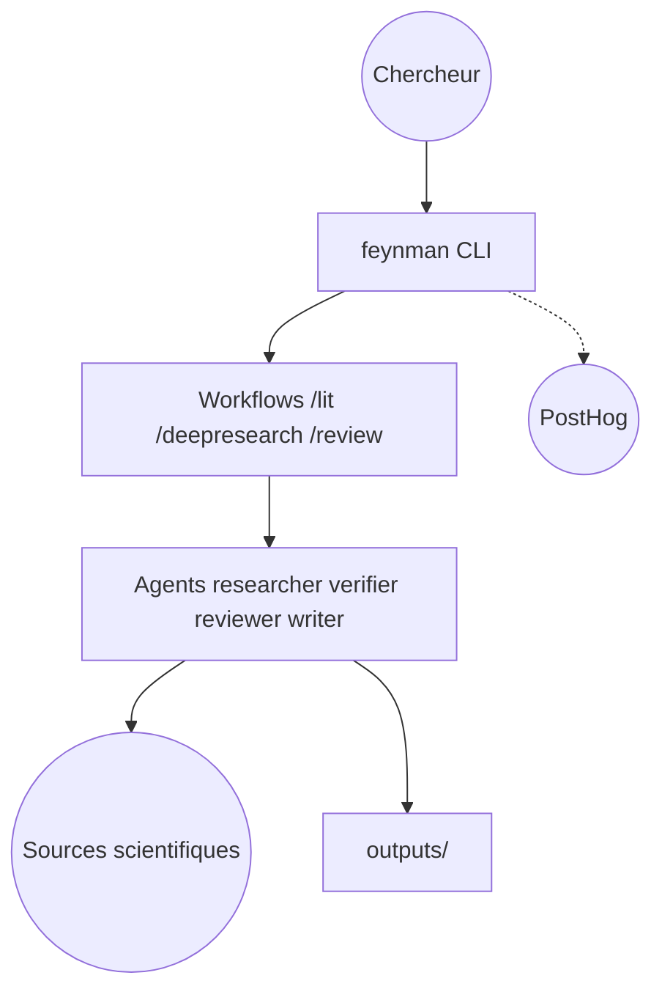

# advaitpaliwal/feynman

> Command-line research agent that searches, reads and cites the scientific literature.

## The problem
A literature review or checking a paper requires manually cross-referencing several databases and public code.

## What it actually does
The README is identical to that of companion-inc/feynman (same stars, same creation date). `/deepresearch`, `/lit`, `/review`, `/audit`, `/replicate`, `/recipe` workflows query alphaXiv, Semantic Scholar, OpenAlex, arXiv, PubMed and the web, with four agents on Pi. No architecture is provided for this repository: not documented here.

## How it is wired


## Trying it
```bash
curl -fsSL https://feynman.is/install | bash
feynman setup
feynman "what do we know about scaling laws"
feynman lit "RLHF alternatives"
```

## Cost and gotchas
Model provider at your expense. Anonymous telemetry to PostHog (can be disabled with `FEYNMAN_TELEMETRY=off`).

## What it is not
Probably a duplicate or former name of the companion-inc/feynman repository: this link is not established by the README. Citations need to be verified.

## Alternatives
- companion-inc/feynman: same README, repository that appears to be owned by the organization.

## For you
Worth watching through the companion-inc/feynman repository rather than this one, since the current owner appears to be the organization.
