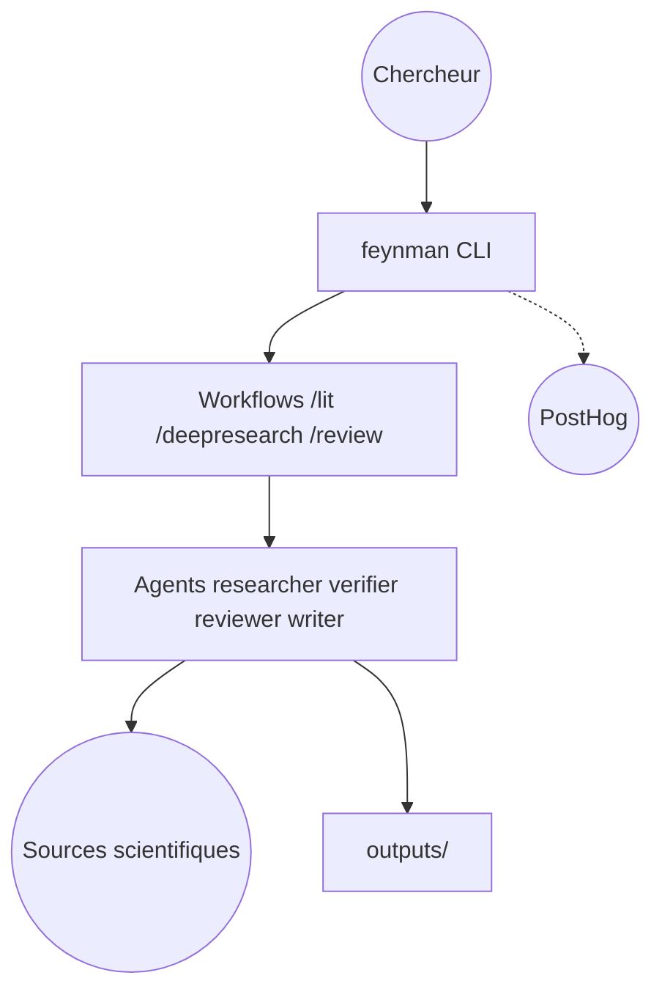

# advaitpaliwal/feynman

> Agent de recherche en ligne de commande qui cherche, lit et cite la littérature scientifique.

## Le problème
Une revue de littérature ou la vérification d'un article exige de croiser à la main plusieurs bases et le code public.

## Ce que ça fait vraiment
Le README est identique à celui de companion-inc/feynman (mêmes étoiles, même date de création). Des workflows `/deepresearch`, `/lit`, `/review`, `/audit`, `/replicate`, `/recipe` interrogent alphaXiv, Semantic Scholar, OpenAlex, arXiv, PubMed et le web, avec quatre agents sur Pi. Aucune architecture n'est fournie pour ce dépôt : non documentée ici.

## Comment c'est branché


## Essayer
```bash
curl -fsSL https://feynman.is/install | bash
feynman setup
feynman "what do we know about scaling laws"
feynman lit "RLHF alternatives"
```

## Coût et pièges
Fournisseur de modèle à ta charge. Télémétrie anonyme vers PostHog (désactivable par `FEYNMAN_TELEMETRY=off`).

## Ce que ce n'est pas
Probablement un doublon ou ancien nom du dépôt companion-inc/feynman : ce lien n'est pas établi par le README. Les citations sont à vérifier.

## Alternatives
- companion-inc/feynman : même README, dépôt qui apparaît porté par l'organisation.

## Pour toi
À surveiller via le dépôt companion-inc/feynman plutôt que celui-ci, car le propriétaire actuel semble être l'organisation.

