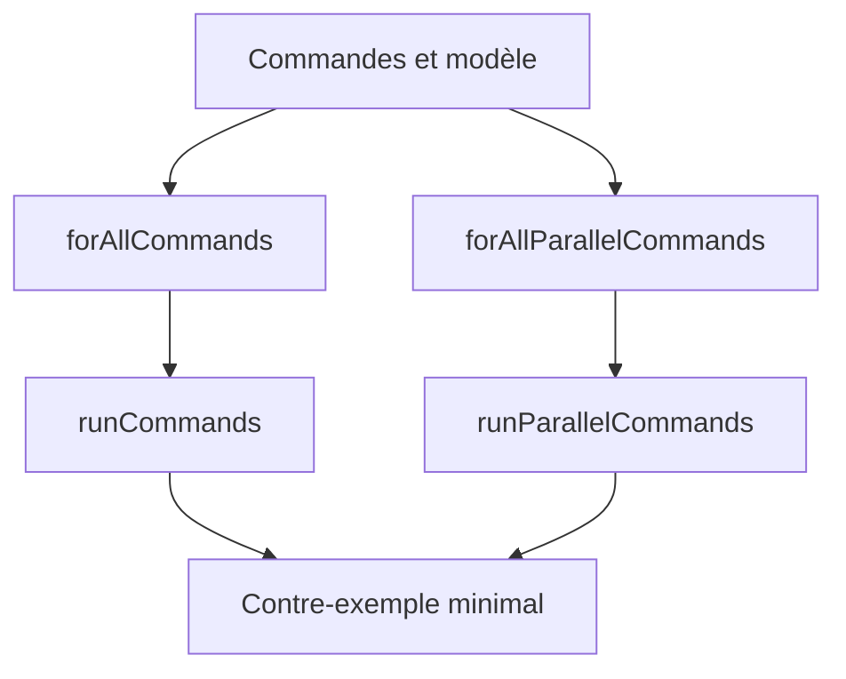

# advancedtelematic/quickcheck-state-machine

> Haskell library based on QuickCheck for model-based testing of stateful programs and finding race conditions.

## The problem
Tests of stateful or concurrent programs are ad hoc and miss race conditions.

## What it actually does
You provide actions, a model, pre- and post-conditions, a transition, a generator and semantics. The sequential property checks the model; the parallel property looks for a valid linearization. Many examples: IORef, CRUD server, process registry.

## How it is wired
Simplified diagram based on the sheet, no diagram provided.


## Trying it
```bash
stack ghci --test
# puis :l test/CrudWebserverDb.hs
```

## Cost and gotchas
Free. Haskell and stack required; archived, last push in 2021.

## What it is not
Not a general-purpose API testing tool: Haskell only and marked experimental.

## Alternatives
Hedgehog: a Haskell library that also handles state machine testing.
PropEr: an equivalent open source Erlang library.
Hypothesis: a Python library with state machines, without a parallel property.

## For you
Ignore: archived and Haskell; the idea of model-based testing is found again with Hypothesis on the Python side.
