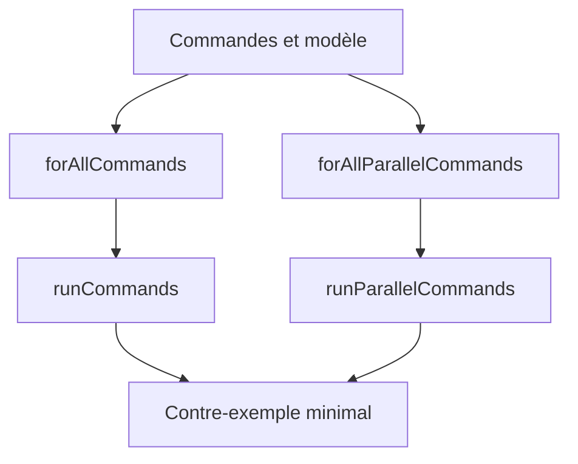

# advancedtelematic/quickcheck-state-machine

> Bibliothèque Haskell basée sur QuickCheck pour tester des programmes à état par modèle et trouver des courses.

## Le problème
Les tests de programmes à état ou concurrents sont ad hoc et ratent les conditions de course.

## Ce que ça fait vraiment
On fournit actions, modèle, pré et post-conditions, transition, générateur et sémantique. La propriété séquentielle vérifie le modèle ; la propriété parallèle cherche une linéarisation valide. Nombreux exemples : IORef, serveur CRUD, registre de processus.

## Comment c'est branché
Schéma simplifié d'après la fiche, sans diagramme fourni.


## Essayer
```bash
stack ghci --test
# puis :l test/CrudWebserverDb.hs
```

## Coût et pièges
Gratuit. Haskell et stack requis ; archivé, dernier push en 2021.

## Ce que ce n'est pas
Pas un outil de test d'API généraliste : Haskell uniquement et marqué expérimental.

## Alternatives
Hedgehog : bibliothèque Haskell qui gère aussi les tests par machine à états.
PropEr : bibliothèque Erlang open source équivalente.
Hypothesis : bibliothèque Python avec machines à états, sans propriété parallèle.

## Pour toi
À ignorer : archivé et Haskell ; l'idée de test par modèle se retrouve avec Hypothesis côté Python.

