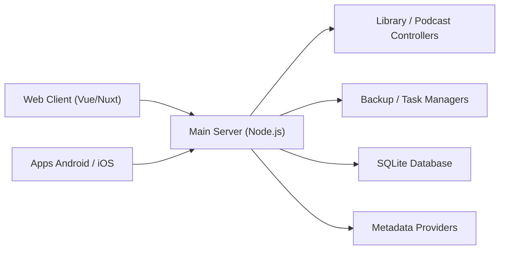

# advplyr/audiobookshelf

> Self-hosted audiobook and podcast server, with web, Android and iOS applications.

## The problem
Listening to your own library of audiobooks and podcasts with progress tracking, without depending on a commercial service.

## What it actually does
A Node.js server streams audio formats on the fly, tracks progress per user and syncs it across devices, detects library changes and handles automatic podcast downloads. It fetches metadata and covers, edits chapters, merges files into m4b, offers ebook reading (epub, pdf, cbr, cbz), Chromecast and automatic backups. SQLite database.

## How it is wired


## Trying it
The README points to the documentation for installation. To develop:
```bash
npm ci
cd client
npm ci
npm run generate
cd ..
npm run dev
```

## Cost and gotchas
Free. The server requires a websocket connection behind a reverse proxy. Imposed folder structure for the library. The Vue frontend is being rewritten in React: frontend PRs are no longer reviewed. Mobile apps in beta; iOS beta is complete. 1,190 open issues; GPL-3.0.

## What it is not
It is not an online streaming service nor a catalog: you provide your own audio files.

## Alternatives
The README names no alternative.

## For you
Ignore: a personal media server unrelated to data/AI/MLOps; it remains decent for home use, but with a frontend in the middle of a rewrite.
