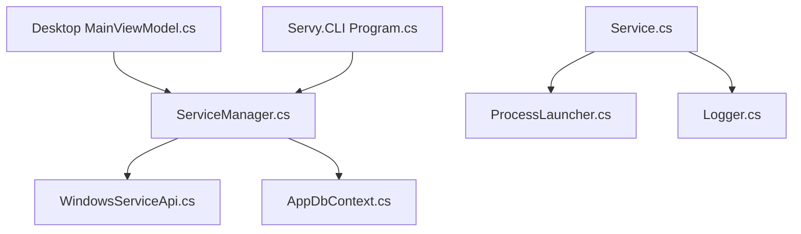

# aelassas/servy

> Runs any application as a native Windows service, with supervision and automatic recovery.

## The problem
Running a script or an executable as a Windows service requires fragile wrappers, with no logs or clean restart.

## What it actually does
Desktop application, CLI and PowerShell module to create services: working directory, priority, environment variables, pre/post launch and stop hooks, health checks, restart policy, log rotation, alerts (email, webhook). Servy Manager shows CPU/RAM and live output.

## How it is wired


## Trying it
```bash
# Aucune commande documentée dans le README : voir le guide d'installation et la documentation.
```

## Cost and gotchas
Windows only (10, 11, Server 2016+, plus a .NET 4.8 build for older versions). Nothing to pay.

## What it is not
Not a multi-machine orchestrator nor a Linux equivalent of systemd.

## Alternatives
No alternative named in the README.

## For you
Ignore: relevant only if you must host a Python job on a Windows server; otherwise off topic.
