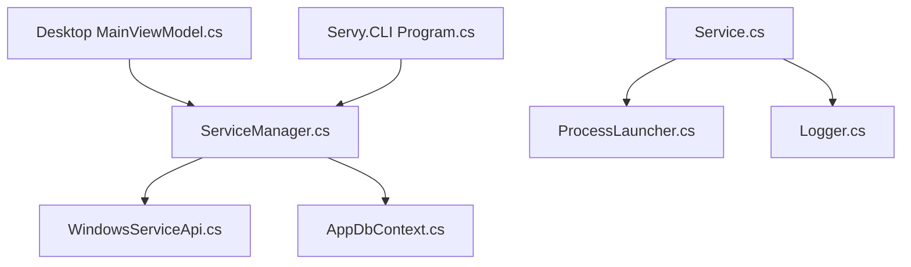

# aelassas/servy

> Exécute n'importe quelle application comme service Windows natif, avec supervision et reprise automatique.

## Le problème
Faire tourner un script ou un exécutable en service Windows demande des wrappers fragiles, sans logs ni redémarrage propre.

## Ce que ça fait vraiment
Application de bureau, CLI et module PowerShell pour créer des services : répertoire de travail, priorité, variables d'environnement, hooks avant/après lancement et arrêt, health checks, politique de redémarrage, rotation des logs, alertes (mail, webhook). Servy Manager affiche CPU/RAM et la sortie en direct.

## Comment c'est branché


## Essayer
```bash
# Aucune commande documentée dans le README : voir le guide d'installation et la documentation.
```

## Coût et pièges
Windows uniquement (10, 11, Server 2016+, plus un build .NET 4.8 pour les anciens). Rien à payer.

## Ce que ce n'est pas
Pas un orchestrateur multi-machines ni un équivalent Linux de systemd.

## Alternatives
Aucune alternative nommée dans le README.

## Pour toi
Ignorer : pertinent seulement si tu dois héberger un job Python sur un serveur Windows ; sinon hors sujet.

