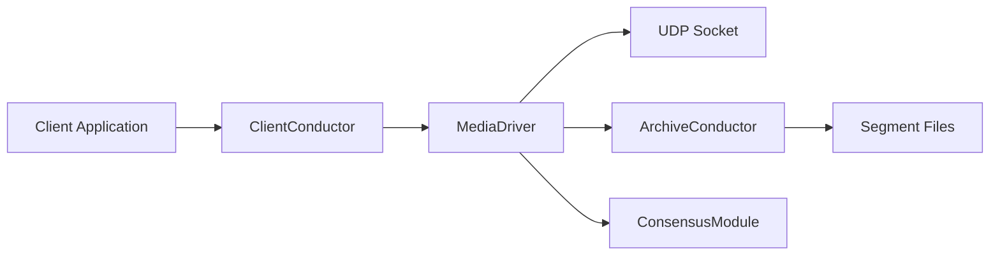

# aeron-io/aeron

> Low-latency UDP and IPC message transport, for Java, C and C++ systems that are highly latency-sensitive.

## The problem
Conventional message brokers add latency and jitter. Trading systems need high throughput with predictable latency.

## What it actually does
Provides Java, C and C++ clients (a .NET client exists) that exchange message streams over UDP unicast, multicast or shared-memory IPC. A Media Driver handles I/O, an Archive module records and replays streams on disk, and Aeron Cluster offers Raft-replicated services. Encoding relies on Simple Binary Encoding.

## How it is wired

## Trying it
No command documented in the README. It points to the Wiki (Java and C++ guides, build).

## Cost and gotchas
The open-source code is free; a paid "Aeron Premium" offering (DPDK, ATS encryption, training, consulting) is sold by Adaptive. Compilation and system tuning are up to you.

## What it is not
Not a turnkey broker like Kafka: it is a low-level transport to integrate. The announced performance improvements are in the proprietary offering.

## Alternatives
- No alternative named in the README.

## For you
Ignore for a data/AI/MLOps profile: it targets minimal-latency financial messaging, not data or model pipelines.
