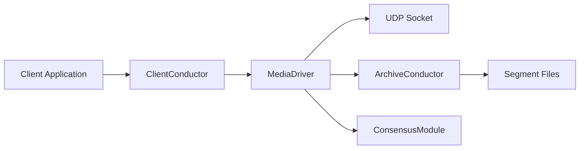

# aeron-io/aeron

> Transport de messages UDP et IPC à faible latence, pour systèmes Java, C et C++ très sensibles à la latence.

## Le problème
Les brokers de messagerie classiques ajoutent latence et gigue. Les systèmes de trading ont besoin d'un débit élevé avec une latence prévisible.

## Ce que ça fait vraiment
Fournit des clients Java, C et C++ (un client .NET existe) qui échangent des flux de messages en UDP unicast, multicast ou IPC par mémoire partagée. Un Media Driver gère les E/S, un module Archive enregistre et rejoue les flux sur disque, et Aeron Cluster offre des services répliqués sur Raft. L'encodage s'appuie sur Simple Binary Encoding.

## Comment c'est branché

## Essayer
Aucune commande documentée dans le README. Il renvoie au Wiki (guides Java, C++, build).

## Coût et pièges
Le code ouvert est gratuit ; une offre « Aeron Premium » payante (DPDK, chiffrement ATS, formation, conseil) est vendue par Adaptive. Compilation et réglage système sont à ta charge.

## Ce que ce n'est pas
Pas un broker clé en main comme Kafka : c'est un transport de bas niveau à intégrer. Les améliorations de performance annoncées sont dans l'offre propriétaire.

## Alternatives
- Aucune alternative nommée dans le README.

## Pour toi
À ignorer pour un profil data/IA/MLOps : il vise la messagerie financière à latence minimale, pas les pipelines de données ou de modèles.

