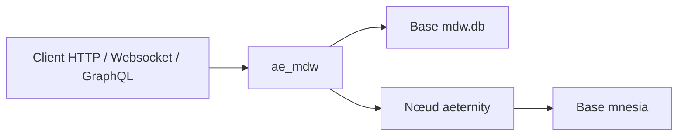

# aeternity/ae_mdw

> Caching and query layer in front of an æternity blockchain node, for blockchain application developers.

## The problem
The æternity node responds slowly and does not support some queries. An indexing layer is needed alongside it.

## What it actually does
The middleware runs in the same container and the same BEAM VM as the node. It exposes an HTTP v3 API (blocks, transactions, names, contracts, oracles, channels, AEX9 tokens and NFTs, statistics) with cursor-based pagination, plus Websocket and GraphQL interfaces. A public instance is hosted by the team.

## How it is wired
Simplified diagram based on the fiche, no diagram provided.



## Trying it
```bash
git clone https://github.com/aeternity/ae_mdw && cd ae_mdw
mkdir -p data/mnesia data/mdw.db
chown -R 1000 data
docker compose up
```

## Cost and gotchas
Docker 27 or later, or Elixir 1.17 with Erlang 26 without Docker. A snapshot of the node database is recommended to speed up synchronization; its size is not documented.

## What it is not
It is not a standalone blockchain node, nor a general-purpose data tool. No page-number pagination: only the `next` and `prev` links work. No license declared.

## Alternatives
No alternative named in the README.

## For you
Ignore: an indexer specific to the æternity blockchain, unrelated to data / AI / MLOps work, and without a clear license.
