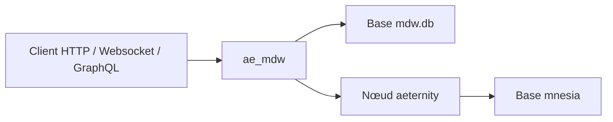

# aeternity/ae_mdw

> Couche de cache et de requêtes devant un nœud de la blockchain æternity, pour développeurs d'applications blockchain.

## Le problème
Le nœud æternity répond lentement et ne supporte pas certaines requêtes. Il faut une couche d'indexation à côté.

## Ce que ça fait vraiment
Le middleware tourne dans le même conteneur et la même VM BEAM que le nœud. Il expose une API HTTP v3 (blocs, transactions, noms, contrats, oracles, canaux, tokens AEX9 et NFT, statistiques) avec pagination par curseur, plus des interfaces Websocket et GraphQL. Une instance publique est hébergée par l'équipe.

## Comment c'est branché
Schéma simplifié d'après la fiche, sans diagramme fourni.



## Essayer
```bash
git clone https://github.com/aeternity/ae_mdw && cd ae_mdw
mkdir -p data/mnesia data/mdw.db
chown -R 1000 data
docker compose up
```

## Coût et pièges
Docker 27 ou plus, ou Elixir 1.17 avec Erlang 26 sans Docker. Un snapshot de base du nœud est conseillé pour accélérer la synchronisation ; sa taille n'est pas documentée.

## Ce que ce n'est pas
Ce n'est pas un nœud de blockchain seul, ni un outil généraliste de données. Pas de pagination par numéro de page : seuls les liens `next` et `prev` fonctionnent. Aucune licence déclarée.

## Alternatives
Aucune alternative nommée dans le README.

## Pour toi
À ignorer : indexeur propre à la blockchain æternity, sans lien avec un travail data / IA / MLOps, et sans licence claire.

