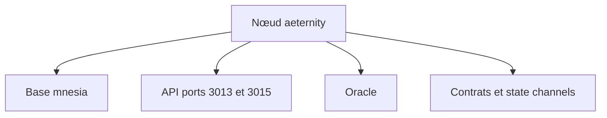

# aeternity/aeternity

> Node for a blockchain written in Erlang, with smart contracts, oracles and a naming system, for node operators.

## The problem
Taking part in the Aeternity blockchain requires a client that syncs the chain, runs the contracts and exposes the network APIs.

## What it actually does
Runs a full node: channel states, contracts, a real-world data oracle and naming. Installation by script or by Docker container. The initial synchronization can be sped up by restoring a database snapshot. The protocol and specifications live in a separate repository.

## How it is wired
Simplified diagram based on the sheet, no diagram provided.



## Trying it
```bash
bash <(curl -s https://install.aeternity.io/install.sh)
docker pull aeternity/aeternity
docker run -p 3013:3013 -p 3015:3015 \
    -v ~/.aeternity/maindb:/home/aeternity/node/data/mnesia \
    aeternity/aeternity
```

## Cost and gotchas
Free, but you need disk space for the chain and time to synchronize. The repository recommends the latest published release rather than the unstable `master` branch.

## What it is not
Not an application library nor an AI tool: it is blockchain infrastructure software. A bug bounty exists, which is not a guarantee of maturity.

## Alternatives
No alternative named in the README.

## For you
Ignore: a blockchain node unrelated to data or MLOps.
