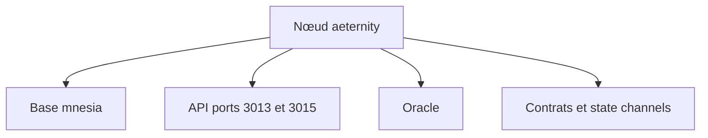

# aeternity/aeternity

> Nœud d'une blockchain écrite en Erlang, avec contrats intelligents, oracles et système de noms, pour opérateurs de nœuds.

## Le problème
Participer à la blockchain Aeternity demande un client qui synchronise la chaîne, exécute les contrats et expose les API réseau.

## Ce que ça fait vraiment
Fait tourner un nœud complet : états de canaux, contrats, oracle de données réelles et nommage. Installation par script ou par conteneur Docker. La synchronisation initiale peut être accélérée en restaurant un instantané de la base. Le protocole et les spécifications vivent dans un dépôt séparé.

## Comment c'est branché
Schéma simplifié d'après la fiche, sans diagramme fourni.



## Essayer
```bash
bash <(curl -s https://install.aeternity.io/install.sh)
docker pull aeternity/aeternity
docker run -p 3013:3013 -p 3015:3015 \
    -v ~/.aeternity/maindb:/home/aeternity/node/data/mnesia \
    aeternity/aeternity
```

## Coût et pièges
Gratuit, mais espace disque pour la chaîne et temps de synchronisation. Le dépôt recommande la dernière version publiée plutôt que la branche `master`, instable.

## Ce que ce n'est pas
Pas une bibliothèque applicative ni un outil d'IA : c'est un logiciel d'infrastructure blockchain. Une prime de bug bounty existe, ce n'est pas un gage de maturité.

## Alternatives
Aucune alternative nommée dans le README.

## Pour toi
À ignorer : nœud de blockchain sans lien avec la donnée ou le MLOps.

