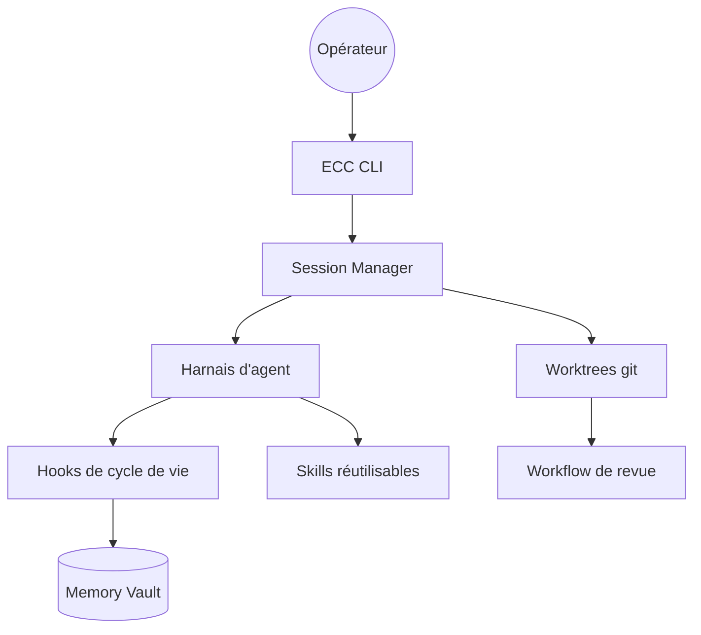

# affaan-m/ECC

> A collection of agents, skills, and hooks to be installed in your code agent, for developers.

## The problem
Without him, each prompt would simply repeat the same process: plan, test, review, and remember.
Nothing would carry over from one session to the next, and nothing would be reusable between projects.

## What it actually does
Install 68 agents, 292 skills, 94 compatibility commands, hooks, rules, and memory.
Imposes a plan → test → implement → review → verify → remember → improve loop.
The primary target is Claude Code, with Codex support, and limited adapters for approximately 12 other harnesses.
Includes AgentShield, a scanner for prompts, hooks, MCP configuration, permissions, and secrets.

## How it is wired


## Trying it
```bash
npx ecc-universal@2.2.2 setup
npx ecc-universal@2.2.2 doctor
npx ecc-universal@2.2.2 uninstall --dry-run
```

## Cost and gotchas
OSS MIT is free; ECC Pro (private repositories) at $19/seat/month. Node 18+, Git, Claude Code 2.1+.

Stacking two installation methods within the same framework duplicates skills, hooks, and commands.

## What it is not
This is not an agent; it is a configuration layer on top of an existing agent.
The `multi-*` commands require a third-party runtime (`ccg-workflow`), which the repository does not provide.
There is no parity between harnesses – refer to the support matrix before relying on it.

## Alternatives
- `addyosmani/agent-skills`: A smaller package, containing 25 skills, with less surface area to audit.
- `DietrichGebert/ponytail`: a single rule, rather than a catalog.

## For you
292 skills installed at once by a single maintainer: This is too much for a single MLOps role. It warrants further investigation.
