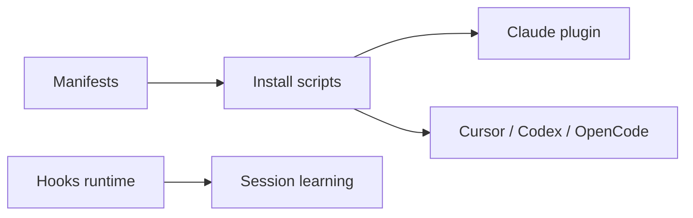

# affaan-m/everything-claude-code

> A system with 68 agents, 292 skills, hooks, and rules for Claude Code, Codex, and other frameworks.

## The problem
An agent forgets the TDD (Task Definition and Description), and repeats the review and verification process for each session. The instructions are also repeated in each prompt.

## What it actually does
A plugin (`ecc@ecc`) and an installer (`ecc-universal`) place agents, skills, commands, rules, and hooks in the chosen harness. Hooks for formatting and security, session memory, and configuration scanning (AgentShield). Adapters for Cursor, OpenCode, Codex, and Gemini.

## How it is wired


## Trying it
```bash
npx ecc-universal@2.2.2 setup
npx ecc-universal@2.2.2 install --profile minimal --target claude
npx ecc-universal@2.2.2 doctor
```

## Cost and gotchas
Node 18+. The rules are always loaded: they consume context. Do not use multiple installation methods. The README mentions a paid option (ECC Pro, starting at $19/seat/month).

## What it is not
Not a neutral product: 292 skills, many of which are not related to data/AI. The hooks execute commands on your machine. The license for the catalog is not declared (the README states MIT).

## Alternatives
The README mentions `ccg-workflow` for the `multi-*` commands. There are no other alternative commands named.

## For you
Things to watch out for: Focus on learning a few key skills (such as TDD and `mle-workflow`), rather than trying to learn everything at once, and review the hooks before activating them.
