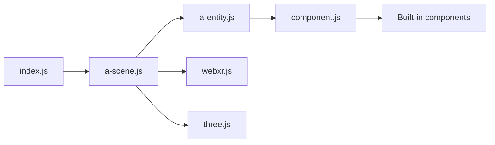

# aframevr/aframe

> Declarative HTML web framework for 3D, VR and AR scenes, on top of three.js.

## The problem
Building a WebXR experience requires a lot of WebGL code and headset handling.

## What it actually does
Tags (`a-scene`, `a-box`, `a-sphere`...) declare the scene; an entity-component architecture renders objects through three.js, with built-in geometries, materials, lights, animations, models, rays and controllers. Also works without a headset (desktop, mobile). Built-in visual inspector, community components (particles, physics, ocean).

## How it is wired


## Trying it
```bash
npm install --save aframe
git clone https://github.com/aframevr/aframe.git
cd aframe && npm install
npm start
```

## Cost and gotchas
Free. Testing in VR requires HTTPS with a self-signed certificate (`npm run start:https`). 338 open issues.

## What it is not
Not a full game engine; physics or multi-user go through third-party components.

## Alternatives
No alternative named in the README (three.js is the base).

## For you
Useful for immersive 3D data visualizations; outside the core data/MLOps trade.
