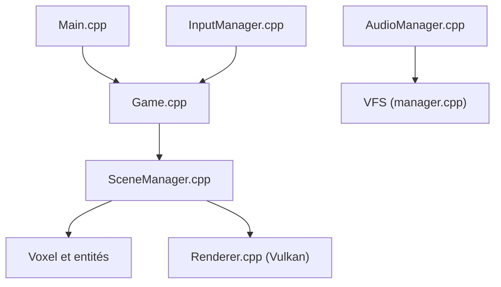

# afritz1/OpenTESArena

> Open-source engine rewritten from scratch for the 1994 game The Elder Scrolls: Arena.

## The problem
The 1994 DOS game is hard to run and to modernize.

## What it actually does
A clean reconstruction of the engine: combat, loot, inventory, merchants, citizens, fast travel, character creation. Incomplete: potions, quests, spells, saving. Vulkan rendering, OpenAL audio, files read through a virtual file system. No game files are distributed.

## How it is wired


## Trying it
```bash
git clone https://github.com/afritz1/OpenTESArena
cd OpenTESArena
mkdir build
cd build
cmake -DCMAKE_BUILD_TYPE=? ..
make -j8
```

## Cost and gotchas
Free, but you need the original game data (free to download from Bethesda or on Steam). Build: CMake, SDL, OpenAL, Vulkan.

## What it is not
Not a complete remake: far from final playability. No model or AI.

## Alternatives
No alternative named in the README.

## For you
Ignore: a retro game project, unrelated to data/AI.
