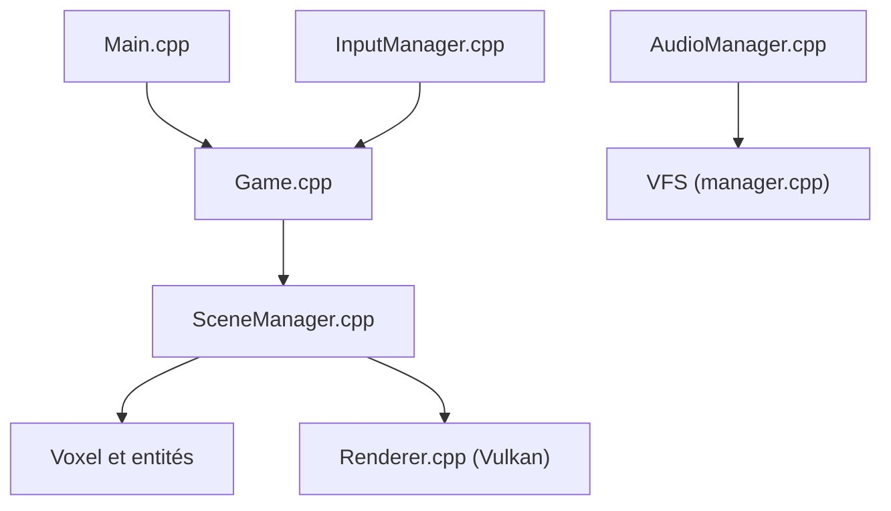

# afritz1/OpenTESArena

> Moteur libre réécrit de zéro pour le jeu The Elder Scrolls: Arena de 1994.

## Le problème
Le jeu DOS de 1994 est difficile à faire tourner et à moderniser.

## Ce que ça fait vraiment
Reconstitution propre du moteur : combat, butin, inventaire, marchands, citoyens, voyage rapide, création de personnage. Incomplets : potions, quêtes, sorts, sauvegarde. Rendu Vulkan, audio OpenAL, fichiers lus par un système virtuel. Aucun fichier du jeu n'est distribué.

## Comment c'est branché


## Essayer
```bash
git clone https://github.com/afritz1/OpenTESArena
cd OpenTESArena
mkdir build
cd build
cmake -DCMAKE_BUILD_TYPE=? ..
make -j8
```

## Coût et pièges
Gratuit, mais il faut les données du jeu original (téléchargeables gratuitement chez Bethesda ou sur Steam). Compilation : CMake, SDL, OpenAL, Vulkan.

## Ce que ce n'est pas
Pas un remake complet : loin de la jouabilité finale. Pas de modèle ni d'IA.

## Alternatives
Aucune alternative nommée dans le README.

## Pour toi
Ignorer : projet de jeu rétro, sans rapport avec data/IA.

