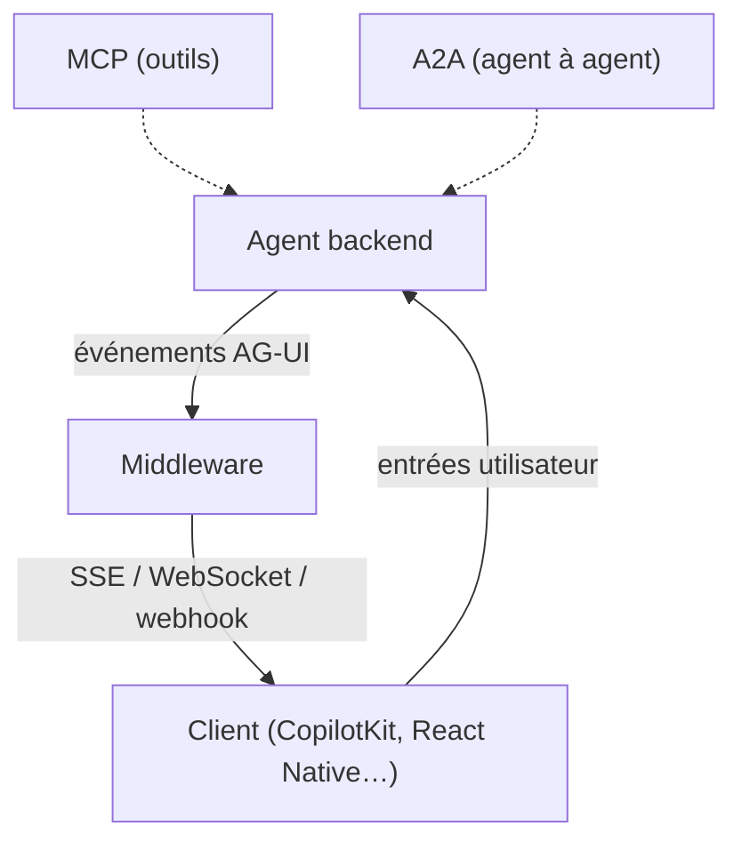

# ag-ui-protocol/ag-ui

> Open event-based protocol that connects AI agents to applications with a user interface.

## The problem
Every agent framework invents its own format for streaming responses, state and tools to the interface.

## What it actually does
Agent backends emit about 16 standard event types, over SSE, WebSockets or webhooks. Features: streaming chat, bidirectional state synchronization, generative UI, frontend-side tools, human in the loop. Provides a reference HTTP implementation, a default connector, SDKs and integrations (LangChain, CrewAI, Google ADK, Mastra, Pydantic AI, LlamaIndex…).

## How it is wired


## Trying it
```bash
npx create-ag-ui-app my-agent-app
```

## Cost and gotchas
Free. The agents and models you plug in are at your expense. Several integrations are marked "In Progress" in the README (Nim, Flowise, Langflow, AWS Bedrock Agents).

## What it is not
Not an agent framework or a model client: it is the layer between agent and interface. It replaces neither MCP nor A2A, which are complementary.

## Alternatives
- CopilotKit: client with first-party AG-UI integration.
- MCP: gives tools to agents (complementary).
- A2A: agent-to-agent communication (complementary).

## For you
Adopt it if you expose agents in an application: a common format avoids coding framework-specific streaming for each one.
