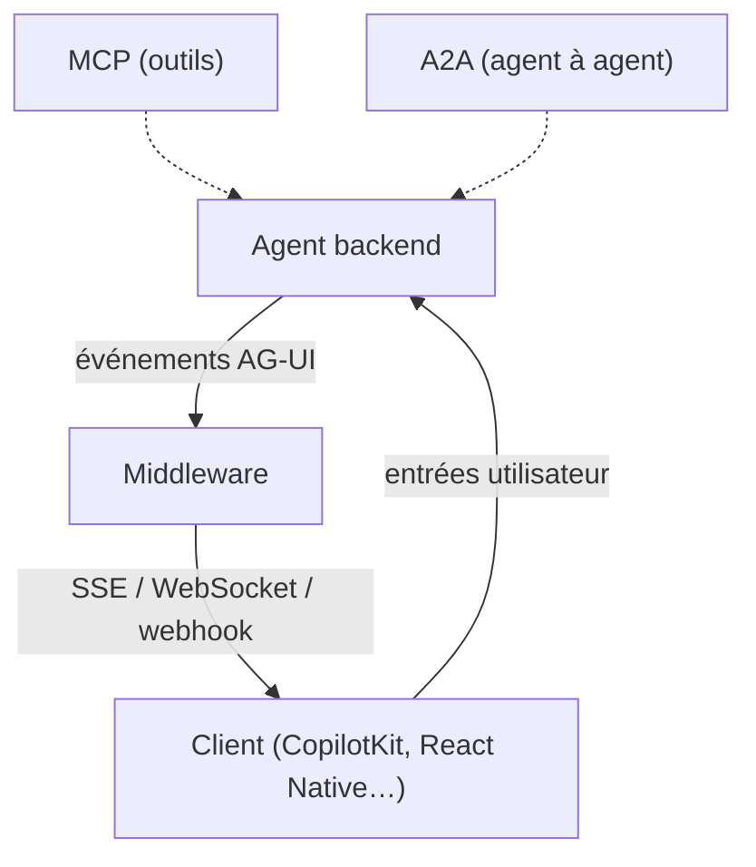

# ag-ui-protocol/ag-ui

> Protocole ouvert à événements qui relie des agents IA à des applications avec interface utilisateur.

## Le problème
Chaque framework d'agents invente son propre format pour diffuser réponses, état et outils vers l'interface.

## Ce que ça fait vraiment
Les backends d'agents émettent environ 16 types d'événements standard, sur SSE, WebSockets ou webhooks. Fonctions : chat en streaming, synchronisation d'état bidirectionnelle, UI générative, outils côté frontend, humain dans la boucle. Fournit une implémentation HTTP de référence, un connecteur par défaut, des SDK et des intégrations (LangChain, CrewAI, Google ADK, Mastra, Pydantic AI, LlamaIndex…).

## Comment c'est branché


## Essayer
```bash
npx create-ag-ui-app my-agent-app
```

## Coût et pièges
Gratuit. Les agents et modèles branchés sont à ta charge. Plusieurs intégrations sont « In Progress » dans le README (Nim, Flowise, Langflow, AWS Bedrock Agents).

## Ce que ce n'est pas
Pas un framework d'agents ni un client de modèles : c'est la couche entre agent et interface. Ne remplace ni MCP ni A2A, qui sont complémentaires.

## Alternatives
- CopilotKit : client avec intégration AG-UI de première partie.
- MCP : donne des outils aux agents (complémentaire).
- A2A : communication d'agent à agent (complémentaire).

## Pour toi
Adopter si tu exposes des agents dans une application : un format commun évite de coder un streaming spécifique à chaque framework.

