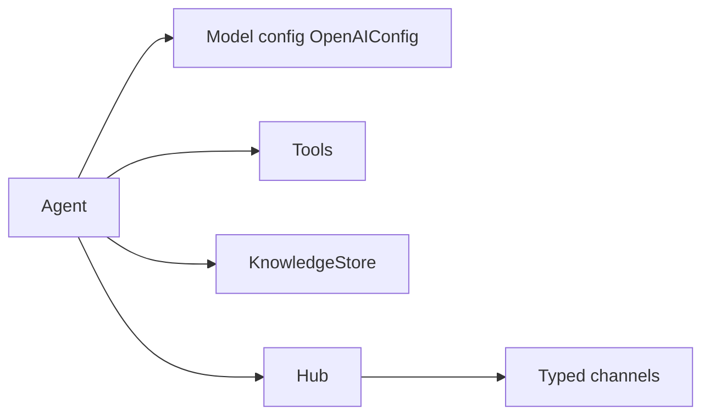

# ag2ai/ag2

> Python AI agent framework, rewritten in v1.0 around an agent network, for developers of agentic applications.

## The problem
Building agents that call tools, ask a human for input and cooperate, without rewriting the orchestration loop.

## What it actually does
Asynchronous `Agent` with `@tool` tools, human feedback via `context.input`, memory (`knowledge=`) and history compaction. Several agents collaborate via a `Hub` and typed channels (`conversation`, `consulting`, `discussion`, `workflow`). The old framework (`autogen`) has been moved to `ag2-classic`.

## How it is wired
The provided diagram describes the old `autogen/` codebase, out of step with the v1.0 README: diagram taken from the README.


## Trying it
```bash
pip install ag2[openai]
export OPENAI_API_KEY="<your-api-key>"
```

## Cost and gotchas
Provider key at your expense. Breaking change: `pip install ag2` is not a compatible upgrade of the old AG2; existing projects must pin `ag2-classic`.

## What it is not
Not a simple rename: `import autogen`, `ConversableAgent` and `GroupChat` have left this repository. The provided architecture diagram describes the old code.

## Alternatives
- ag2-classic: to keep existing AutoGen code.

## For you
Worth watching: interesting for trying v1.0, but the break with the classic version and the outdated diagram call for caution.
