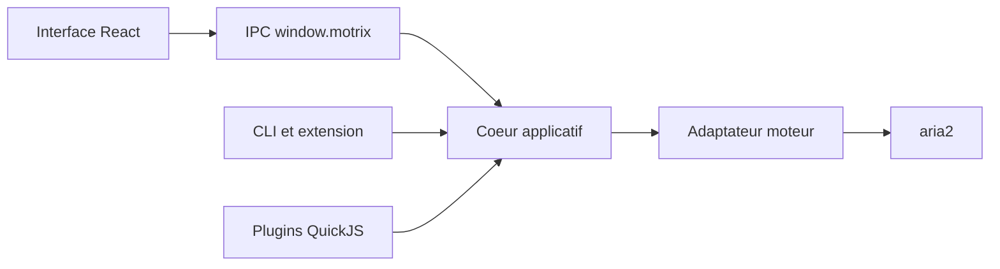

# agalwood/Motrix

> HTTP, FTP, BitTorrent and magnet download manager for a workstation or headless server.

## The problem
Bringing direct downloads and torrents together in a single interface, controllable by browser, command line and server.

## What it actually does
Motrix "Turbo" (v2, currently in beta) is rewritten in Electron, React and TypeScript, with an embedded aria2 engine, SQLite sessions, the MDXP protocol (JSON-RPC 2.0), a `@motrix/cli` client, a browser extension and plugins in a QuickJS sandbox. A headless server runs under Node.js or Docker with a web interface. The architecture analysis mentions Vue (v1): the v2 README is authoritative.

## How it is wired


## Trying it
```bash
npm install -g @motrix/cli
motrix add https://example.com/file.iso --save-dir ~/Downloads
motrix list
```

## Cost and gotchas
Free. Beta: the README asks you to back up your data and warns that migration from v1 is not validated. Windows binaries are unsigned (SmartScreen warning). License not identified by GitHub.

## What it is not
It is not a stable release, and it does not resolve site downloads without a plugin.

## Alternatives
No alternative named in the README.

## For you
Ignore: general-purpose download manager in beta, with no particular benefit for your data or AI work.
