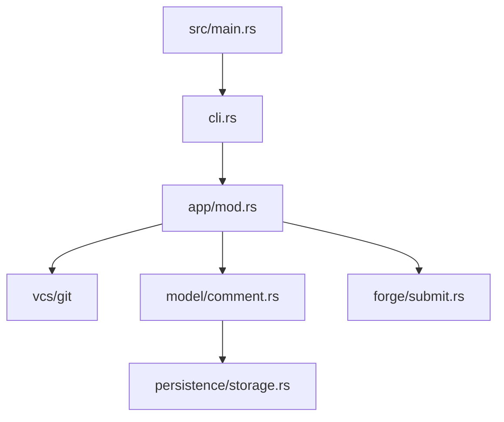

# agavra/tuicr

> Terminal code-review interface with Vim keybindings, with export to forges or the clipboard.

## The problem
Reviewing a diff in the terminal without structured comments forces you to go through the browser or copy by hand.

## What it actually does
- GitHub-style continuous diff, comments per line, range, file or review.
- Tracking of what has been reviewed, kept between sessions.
- Export to GitHub, GitLab, Gitea, Bitbucket, Azure DevOps, Gerrit, clipboard or stdout.
- Works with git, jj and mercurial; a Markdown format intended for coding agents.

## How it is wired


## Trying it
```bash
curl -fsSL tuicr.dev/install.sh | sh
tuicr -w
tuicr -r main..HEAD
tuicr pr 125
tuicr --stdout
```

## Cost and gotchas
Free. To push a review, you need the forge's tool (`gh`, `glab`, `tea`, `bkt`) authenticated, or a token. The install script runs from the web.

## What it is not
Not a review host: it relies on your forge. Bitbucket supports neither pull requests nor drafts.

## Alternatives
- hunk: another terminal diff viewer, without export to forges.
- lumen: another viewer, with a more partial Vim model.
- `gh pr review`: global-level review only, no inline comments.

## For you
Worth watching: useful to review code or a notebook in the terminal and send the remarks back to a coding agent; young, single maintainer.
