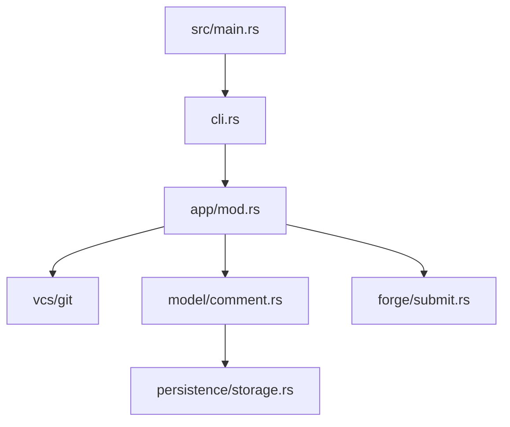

# agavra/tuicr

> Interface terminal de revue de code aux raccourcis Vim, avec export vers les forges ou le presse-papiers.

## Le problème
Relire un diff dans le terminal sans commentaires structurés oblige à passer par le navigateur ou à copier à la main.

## Ce que ça fait vraiment
- Diff continu façon GitHub, commentaires par ligne, plage, fichier ou revue.
- Suivi de ce qui est relu, conservé entre sessions.
- Export vers GitHub, GitLab, Gitea, Bitbucket, Azure DevOps, Gerrit, presse-papiers ou stdout.
- Fonctionne avec git, jj et mercurial ; un format Markdown destiné aux agents de code.

## Comment c'est branché


## Essayer
```bash
curl -fsSL tuicr.dev/install.sh | sh
tuicr -w
tuicr -r main..HEAD
tuicr pr 125
tuicr --stdout
```

## Coût et pièges
Gratuit. Pour pousser une revue, il faut l'outil de la forge (`gh`, `glab`, `tea`, `bkt`) authentifié, ou un jeton. Le script d'installation s'exécute depuis le web.

## Ce que ce n'est pas
Pas un hébergeur de revues : il s'appuie sur ta forge. Bitbucket ne gère ni demande de changements ni brouillon.

## Alternatives
- hunk : autre visionneuse de diff en terminal, sans export vers les forges.
- lumen : autre visionneuse, avec un modèle Vim plus partiel.
- `gh pr review` : revue au niveau global seulement, sans commentaire en ligne.

## Pour toi
À surveiller : utile pour relire du code ou un notebook en terminal et renvoyer les remarques à un agent de code ; jeune, au mainteneur unique.

