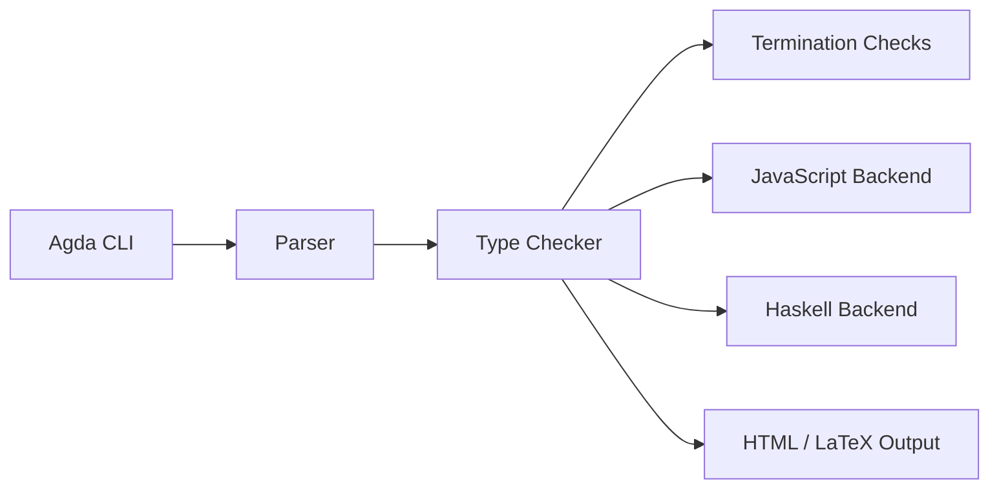

# agda/agda

> Implementation of the Agda dependently typed language, for those who prove or program with strong types.

## The problem
Formally verifying properties of programs requires a language where types express those properties.

## What it actually does
Based on the architecture: the user writes Agda code, the tool checks it (parsing, scope checking, type checking, termination, size solver) then can compile it to JavaScript or Haskell. HTML and LaTeX output, Emacs interaction. The compiler's Haskell code was not sampled: these links are unverified.

## How it is wired

## Trying it
No command documented in the README: it points to the manual (installation, "a taste of Agda").

## Cost and gotchas
Free. 1,049 open issues. The standard library is a separate repository.

## What it is not
Not a data science tool: a proof assistant and research language.

## Alternatives
No alternative named in the README.

## For you
Worth watching: cultural more than useful in MLOps, open it only if formal verification interests you.
