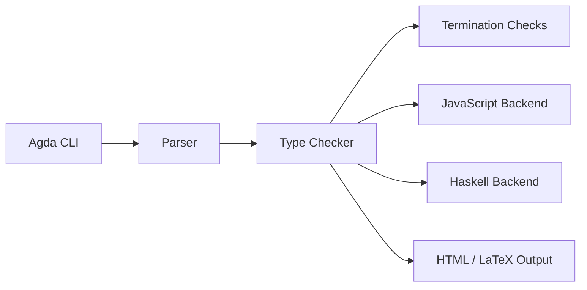

# agda/agda

> Implémentation du langage Agda, à types dépendants, pour qui prouve ou programme avec des types forts.

## Le problème
Vérifier formellement des propriétés de programmes demande un langage où les types expriment ces propriétés.

## Ce que ça fait vraiment
D'après l'architecture : l'utilisateur écrit du code Agda, l'outil le vérifie (analyse, portée, vérification de types, termination, solveur de tailles) puis peut le compiler vers JavaScript ou Haskell. Sorties HTML et LaTeX, interaction avec Emacs. Le code Haskell du compilateur n'a pas été échantillonné : ces liens sont non vérifiés.

## Comment c'est branché

## Essayer
Aucune commande documentée dans le README : renvoie au manuel (installation, « a taste of Agda »).

## Coût et pièges
Gratuit. 1 049 issues ouvertes. La bibliothèque standard est un dépôt séparé.

## Ce que ce n'est pas
Pas un outil de data science : un assistant de preuve et langage de recherche.

## Alternatives
Aucune alternative nommée dans le README.

## Pour toi
À surveiller : culturel plus qu'utile en MLOps, à ouvrir seulement si la vérification formelle t'intéresse.

