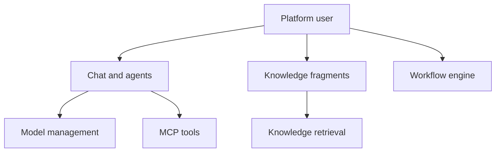

# ageerle/ruoyi-ai

> Full-stack enterprise AI assistant platform: multi-agents, RAG, visual workflows, administration.

## The problem
Building a complete AI platform (models, knowledge base, tools, workflows, accounts) requires assembling many building blocks.

## What it actually does
Spring Boot 3.5.8 backend with Langchain4j, MySQL, Redis and vector databases (Milvus, Weaviate, Qdrant). Integrates several models, local RAG, MCP tools and skills, a drag-and-drop workflow designer with SSE execution, and agents in Supervisor mode. Vue 3 front end for users and administrators.

## How it is wired


## Trying it
```bash
git clone --depth 1 --branch v3.1.0 https://github.com/ageerle/ruoyi-ai.git
cd ruoyi-ai
cp docs/docker/ruoyi-ai/.env.example docs/docker/ruoyi-ai/.env
docker compose --env-file docs/docker/ruoyi-ai/.env \
  -f docs/docker/ruoyi-ai/docker-compose-all.yaml up -d
```

## Cost and gotchas
Docker Compose V2 and several services (MySQL, Redis, Weaviate, MinIO) to run. Model API keys are at your expense. Default credentials (admin / admin123) and exposed ports: change them before any public deployment. Documentation partly in Chinese.

## What it is not
Not a library: a complete application to deploy. The links in the diagram are largely unverified in the code.

## Alternatives
The README mentions integration of Coze, DIFY, FastGPT and RAGFlow as pluggable platforms.

## For you
Worth watching: a useful reference for a RAG and agents platform in Java, but heavy and centered on the Chinese ecosystem.
