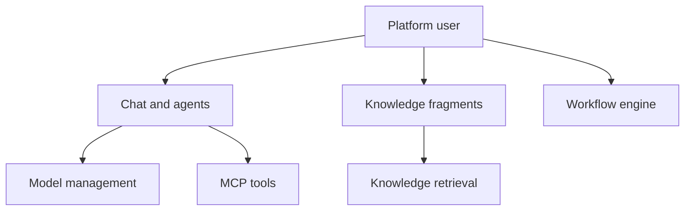

# ageerle/ruoyi-ai

> Plateforme d'assistant IA d'entreprise full-stack : multi-agents, RAG, workflows visuels, administration.

## Le problème
Monter une plateforme IA complète (modèles, base de connaissances, outils, workflows, comptes) demande d'assembler beaucoup de briques.

## Ce que ça fait vraiment
Backend Spring Boot 3.5.8 avec Langchain4j, MySQL, Redis et bases vectorielles (Milvus, Weaviate, Qdrant). Intègre plusieurs modèles, RAG local, outils MCP et skills, concepteur de workflows en glisser-déposer avec exécution en SSE, agents en mode Supervisor. Front Vue 3 pour utilisateurs et administrateurs.

## Comment c'est branché


## Essayer
```bash
git clone --depth 1 --branch v3.1.0 https://github.com/ageerle/ruoyi-ai.git
cd ruoyi-ai
cp docs/docker/ruoyi-ai/.env.example docs/docker/ruoyi-ai/.env
docker compose --env-file docs/docker/ruoyi-ai/.env \
  -f docs/docker/ruoyi-ai/docker-compose-all.yaml up -d
```

## Coût et pièges
Docker Compose V2 et plusieurs services (MySQL, Redis, Weaviate, MinIO) à faire tourner. Clés d'API des modèles à ta charge. Identifiants par défaut (admin / admin123) et ports exposés : à changer avant toute mise en ligne. Documentation en partie en chinois.

## Ce que ce n'est pas
Pas une bibliothèque : une application complète à déployer. Les liens du diagramme sont en grande partie non vérifiés dans le code.

## Alternatives
Le README cite l'intégration de Coze, DIFY, FastGPT et RAGFlow comme plateformes branchables.

## Pour toi
À surveiller : référence utile pour une plateforme RAG et agents en Java, mais lourde et centrée sur l'écosystème chinois.

