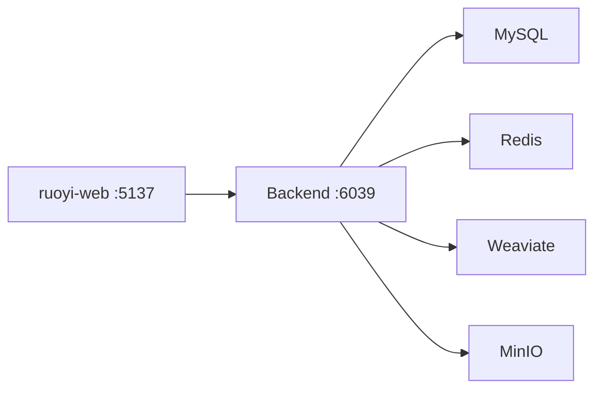

# ageerle/ruoyi-web

> Vue 3 user interface of the RuoYi-AI platform: conversations, agents and knowledge-base question answering.

## The problem
The RuoYi-AI platform has a backend and an admin, but end users need a chat interface.

## What it actually does
Vue 3, TypeScript, Ant Design Vue, Pinia and Vite frontend. It connects to the RuoYi-AI backend (`UPSTREAM_URL` variable). The README mostly describes Docker deployment: all services (backend, admin, MySQL, Redis, Weaviate, MinIO) are launched through a compose file in the backend repository.

## How it is wired
Simplified diagram based on the sheet, no diagram provided.



## Trying it
```bash
git clone https://github.com/ageerle/ruoyi-ai.git
cd ruoyi-ai
docker-compose -f docker-compose-all.yaml up -d
```

## Cost and gotchas
Useless without the separate backend. Demo admin account admin / admin123 to be changed. Node 22.13 and pnpm 11.0.9 for local development (npm and Yarn not supported).

## What it is not
Not a standalone product: only the visible part. It contains neither a model nor RAG logic.

## Alternatives
No alternative named in the README.

## For you
Watch: useful as an example of a full AI chat stack with a vector database, but only the facade is here; the substance is in another repository.
