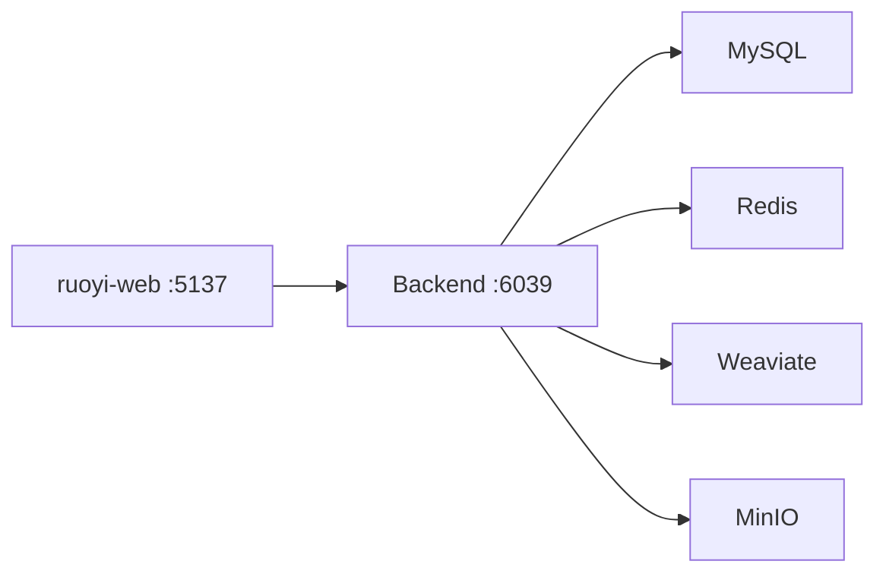

# ageerle/ruoyi-web

> Interface utilisateur Vue 3 de la plateforme RuoYi-AI : conversations, agents et questions-réponses sur base de connaissances.

## Le problème
La plateforme RuoYi-AI a un backend et une administration, mais les utilisateurs finaux ont besoin d'une interface de chat.

## Ce que ça fait vraiment
Frontend Vue 3, TypeScript, Ant Design Vue, Pinia et Vite. Il se connecte au backend RuoYi-AI (variable `UPSTREAM_URL`). Le README décrit surtout le déploiement Docker : l'ensemble des services (backend, admin, MySQL, Redis, Weaviate, MinIO) se lance par un fichier compose du dépôt backend.

## Comment c'est branché
Schéma simplifié d'après la fiche, sans diagramme fourni.



## Essayer
```bash
git clone https://github.com/ageerle/ruoyi-ai.git
cd ruoyi-ai
docker-compose -f docker-compose-all.yaml up -d
```

## Coût et pièges
Inutile sans le backend séparé. Compte de démonstration admin / admin123 à changer. Node 22.13 et pnpm 11.0.9 pour le développement local (npm et Yarn non pris en charge).

## Ce que ce n'est pas
Pas un produit autonome : seulement la partie visible. Il ne contient ni modèle ni logique de RAG.

## Alternatives
Aucune alternative nommée dans le README.

## Pour toi
Surveiller : utile comme exemple de pile complète de chat IA avec base vectorielle, mais seule la façade est ici ; le fond est dans un autre dépôt.

