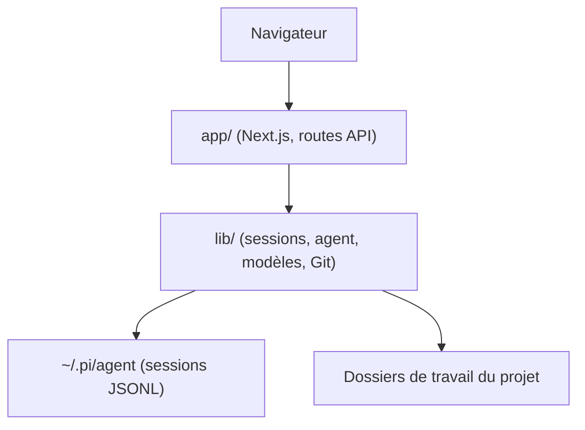

# agegr/pi-web

> Local web interface for the pi coding agent: sessions, models, files and diffs in the browser.

## The problem
The pi agent lives in the terminal: finding, resuming and comparing its conversations and files there is impractical.

## What it actually does
Reads the same session files and the same configuration as pi (`~/.pi/agent`). Lets you browse, resume, rename and export sessions, launch agent turns, manage models, keys and skills, explore project files, Git diffs and worktrees. Optional password for remote access.

## How it is wired

Simplified diagram based on the repository structure.

## Trying it
```bash
npx @agegr/pi-web@latest
npm install -g @agegr/pi-web@latest
pi-web status
pi-web stop
```

## Cost and gotchas
Node 22.19.0 or later. You need a key or a connection to a model provider, at your own expense. Listens on 127.0.0.1 by default; opening it to 0.0.0.0 exposes a high-privilege agent: set `PI_WEB_PASSWORD`, and do not expose it over plain HTTP.

## What it is not
Not an agent in itself: it depends on pi. Not a general file browser (limited to known folders). The password does not encrypt the connection.

## Alternatives
No alternative named in the README.

## For you
Watch: only if pi is already your coding agent; otherwise nothing to gain.
