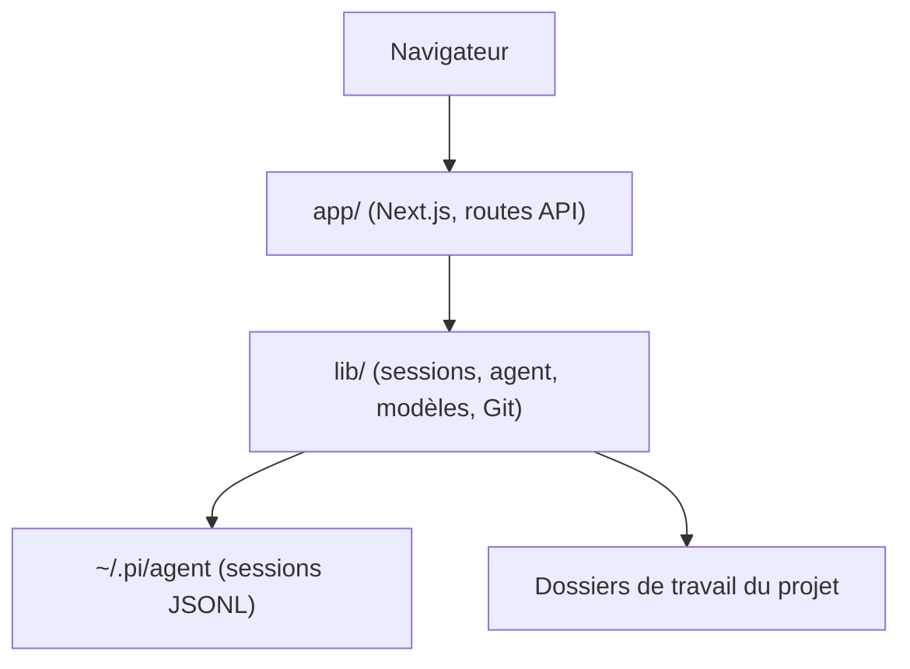

# agegr/pi-web

> Interface web locale pour l'agent de code pi : sessions, modèles, fichiers et diffs dans le navigateur.

## Le problème
L'agent pi vit dans le terminal : retrouver, reprendre et comparer ses conversations et ses fichiers y est peu pratique.

## Ce que ça fait vraiment
Lit les mêmes fichiers de session et la même configuration que pi (`~/.pi/agent`). Permet de parcourir, reprendre, renommer et exporter des sessions, de lancer des tours d'agent, de gérer modèles, clés et skills, d'explorer les fichiers du projet, les diffs Git et les worktrees. Mot de passe optionnel pour l'accès distant.

## Comment c'est branché

Schéma simplifié d'après la structure du dépôt.

## Essayer
```bash
npx @agegr/pi-web@latest
npm install -g @agegr/pi-web@latest
pi-web status
pi-web stop
```

## Coût et pièges
Node 22.19.0 ou plus. Il faut une clé ou une connexion à un fournisseur de modèles, à ta charge. Écoute sur 127.0.0.1 par défaut ; ouvrir à 0.0.0.0 expose un agent à privilèges élevés : définir `PI_WEB_PASSWORD`, et ne pas l'exposer en HTTP simple.

## Ce que ce n'est pas
Pas un agent en soi : il dépend de pi. Pas un navigateur de fichiers général (limité aux dossiers connus). Le mot de passe ne chiffre pas la connexion.

## Alternatives
Aucune alternative nommée dans le README.

## Pour toi
À surveiller : seulement si pi est déjà ton agent de code ; sinon rien à y gagner.

