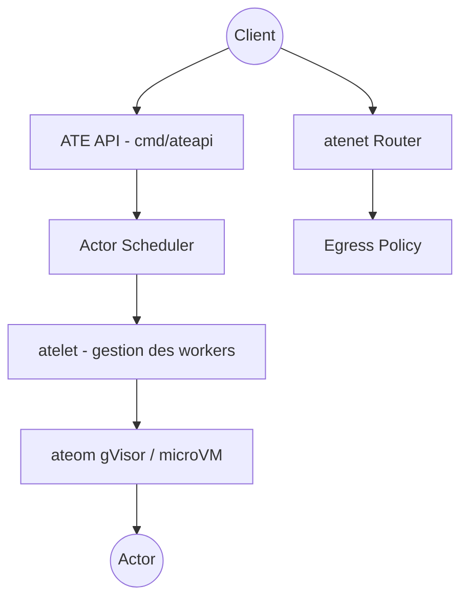

# agent-substrate/substrate

> Kubernetes runtime that isolates and suspends thousands of agents in gVisor or microVM sandboxes.

## The problem
Running many low-activity, untrusted agents on a cluster is expensive in resources and creates secret-exfiltration risks.

## What it actually does
Maps a large number of "actors" onto a small pool of workers: idle actors are serialized (memory and disk snapshot) then restored on demand. Each actor runs in gVisor or Cloud Hypervisor, with a SPIFFE identity, a network closed by default, and an egress gateway that injects credentials outside the sandbox. The README claims resume in under 500 ms, without proving it here.

## How it is wired


## Trying it
```bash
hack/create-kind-cluster.sh
export ATE_INSTALL_KIND=true
go run ./cmd/ate-setup deploy ate-system --credential-provider='{"name":"k8s.io"}' \
  --ingress-allowed-spiffe-ids=spiffe://cluster.local/ns/ate-system/sa/atenet-client
go run ./cmd/ate-setup deploy demo counter
kubectl ate create actor my-counter-1 -a ate-demo-counter --template counter
```

## Cost and gotchas
Requires Go, kubectl, Docker and a Kubernetes cluster (kind locally). Plain Linux containers are not supported. Beyond a thousand sandboxes, kernel parameters (neighbor table) need tuning. The project calls itself "very young" and 1,102 issues are open.

## What it is not
Not an agent SDK or framework: it is an execution layer. Not a turnkey platform outside Kubernetes.

## Alternatives
No alternative named in the README.

## For you
Relevant for an MLOps team that must isolate agent code on Kubernetes; too heavy for individual use, worth watching.
