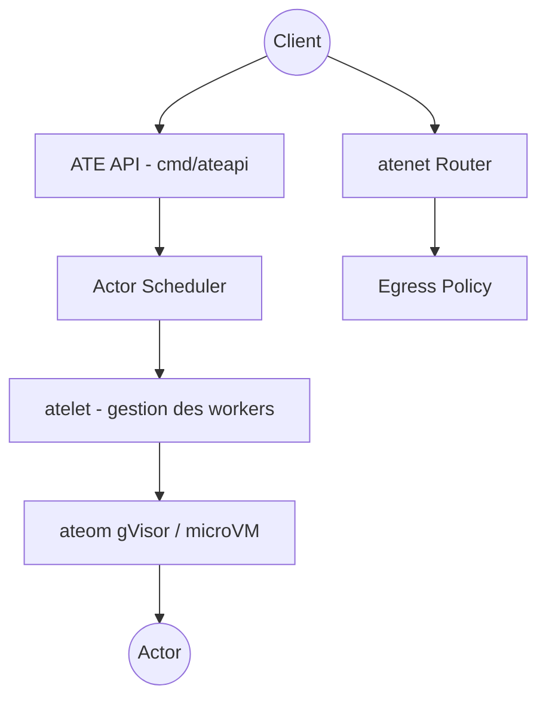

# agent-substrate/substrate

> Runtime Kubernetes qui isole et met en veille des milliers d'agents dans des sandbox gVisor ou microVM.

## Le problème
Faire tourner de nombreux agents peu actifs et non fiables sur un cluster coûte cher en ressources et pose des risques d'exfiltration de secrets.

## Ce que ça fait vraiment
Associe un grand nombre d'« acteurs » à un petit pool de workers : les acteurs inactifs sont sérialisés (snapshot mémoire et disque) puis restaurés à la demande. Chaque acteur tourne dans gVisor ou Cloud Hypervisor, avec identité SPIFFE, réseau fermé par défaut et passerelle de sortie qui injecte les identifiants hors du sandbox. Le README annonce une reprise sous 500 ms, sans la prouver ici.

## Comment c'est branché


## Essayer
```bash
hack/create-kind-cluster.sh
export ATE_INSTALL_KIND=true
go run ./cmd/ate-setup deploy ate-system --credential-provider='{"name":"k8s.io"}' \
  --ingress-allowed-spiffe-ids=spiffe://cluster.local/ns/ate-system/sa/atenet-client
go run ./cmd/ate-setup deploy demo counter
kubectl ate create actor my-counter-1 -a ate-demo-counter --template counter
```

## Coût et pièges
Demande Go, kubectl, Docker et un cluster Kubernetes (kind en local). Les conteneurs Linux simples ne sont pas pris en charge. Au-delà de mille sandbox, ajuster les paramètres du noyau (table de voisins). Le projet se dit « très jeune » et 1 102 issues sont ouvertes.

## Ce que ce n'est pas
Pas un SDK d'agent ni un framework : c'est une couche d'exécution. Pas une plateforme clé en main hors Kubernetes.

## Alternatives
Aucune alternative nommée dans le README.

## Pour toi
Pertinent pour une équipe MLOps qui doit isoler du code d'agents sur Kubernetes ; trop lourd pour un usage individuel, à surveiller.

