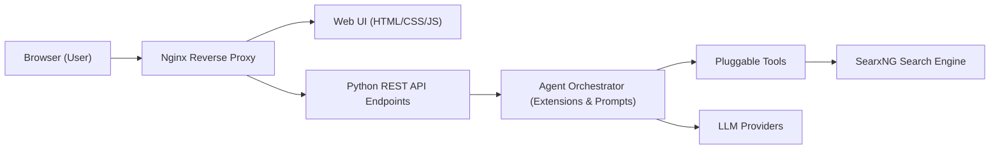

# agent0ai/agent-zero

> Agent framework in a Docker container with a Linux desktop, an annotatable browser and document co-editing.

## The problem
Chat agents can neither use graphical software nor work on real files in a visible and reversible way.

## What it actually does
Gives the agent an XFCE desktop inside the container, visible in the interface, with LibreOffice and other software.
Built-in browser with an Annotate mode: click an element to modify it, inspect it or reimplement it.
Isolated projects (files, memory, secrets), sub-agents, plugins, skills, MCP, A2A; "Time Travel" snapshots of the workspace.
The A0 CLI connector links the instance to your host machine.

## How it is wired


## Trying it
```bash
docker run -p 80:80 -v a0_usr:/a0/usr agent0ai/agent-zero
curl -fsSL https://bash.agent-zero.ai | bash
curl -LsSf https://cli.agent-zero.ai/install.sh | sh
```

## Cost and gotchas
An LLM provider must be configured (or a Codex plan via OAuth). Installations are done through `curl | bash`, to be reviewed before running.

## What it is not
Not risk-free: the README recommends not mounting your home directory and restricting host access. Time Travel does not replace Git or backups. License not identified by GitHub.

## Alternatives
No alternative named in the README.

## For you
Worth watching: Docker isolation and controlled host access make it a safer agent sandbox than others, but the license remains to be verified.
