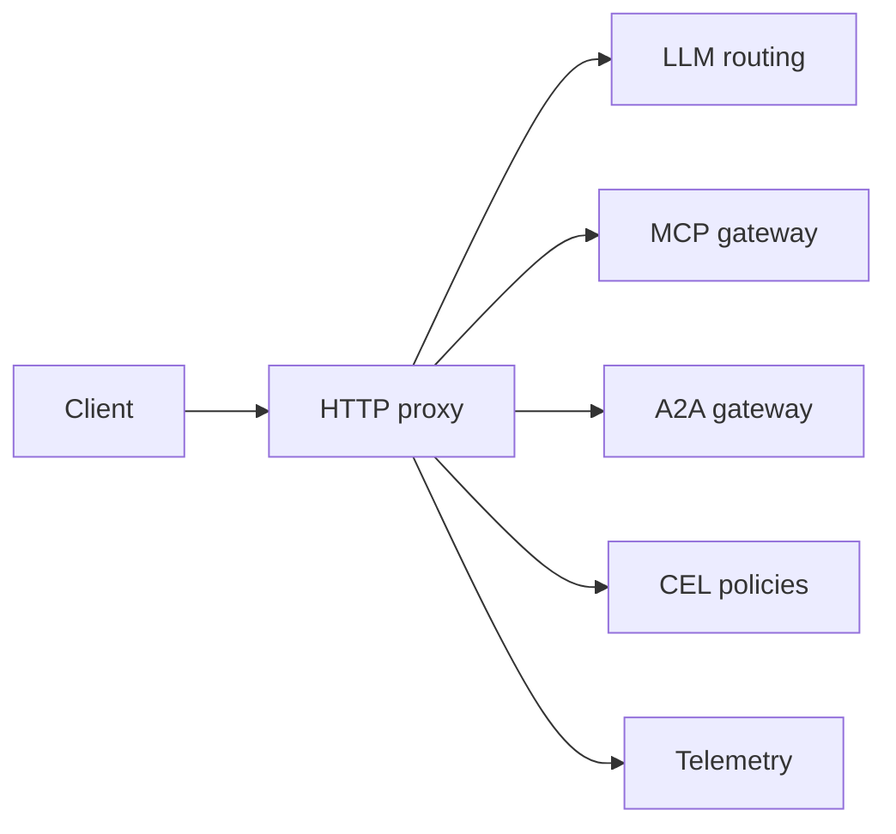

# agentgateway/agentgateway

> Open-source proxy for agent-LLM, agent-tool (MCP) and agent-agent (A2A) traffic, for AI teams.

## The problem
Agents call LLMs, tools and other agents with no central security or observability control.

## What it actually does
Routes to OpenAI, Anthropic, Gemini, Bedrock through an OpenAI-compatible API with budgets and failover. Federates MCP tools, handles A2A, applies guardrails (regex, moderation, Bedrock Guardrails), JWT/OAuth auth, RBAC in CEL, rate limiting, OpenTelemetry. Built-in UI; standalone mode or Kubernetes controller.

## How it is wired

## Trying it
The README points to the standalone and Kubernetes quickstarts on agentgateway.dev/docs; no command appears there.

## Cost and gotchas
Calls to LLM providers are still billed by them. A project from March 2025, young.

## What it is not
Not an agent framework: it sits between agents and services.

## Alternatives
No alternative cited in the README.

## For you
Worth adopting on a trial basis: a single LLM/MCP gateway for budgets, guardrails and traces is a real MLOps need.
