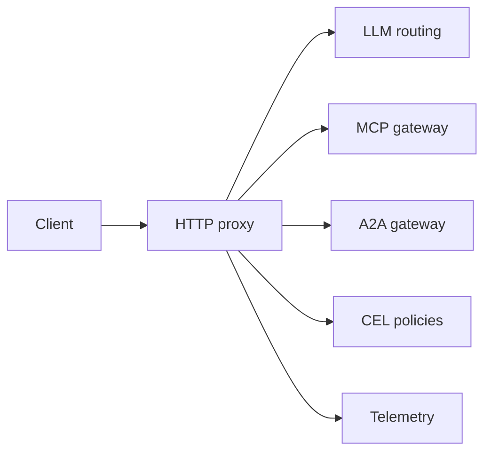

# agentgateway/agentgateway

> Proxy open source pour trafic agent-LLM, agent-outil (MCP) et agent-agent (A2A), pour équipes IA.

## Le problème
Les agents appellent LLM, outils et autres agents sans contrôle central de sécurité ni d'observabilité.

## Ce que ça fait vraiment
Route vers OpenAI, Anthropic, Gemini, Bedrock via une API compatible OpenAI avec budgets et failover. Fédère des outils MCP, gère A2A, applique garde-fous (regex, modération, Bedrock Guardrails), auth JWT/OAuth, RBAC en CEL, limitation de débit, OpenTelemetry. UI intégrée ; mode standalone ou contrôleur Kubernetes.

## Comment c'est branché

## Essayer
Le README renvoie aux quickstarts standalone et Kubernetes sur agentgateway.dev/docs ; aucune commande n'y figure.

## Coût et pièges
Les appels aux fournisseurs LLM restent facturés par eux. Projet de mars 2025, jeune.

## Ce que ce n'est pas
Pas un framework d'agents : il se place entre agents et services.

## Alternatives
Aucune alternative citée dans le README.

## Pour toi
À adopter à l'essai : une passerelle LLM/MCP unique pour budgets, garde-fous et traces est un besoin MLOps réel.

