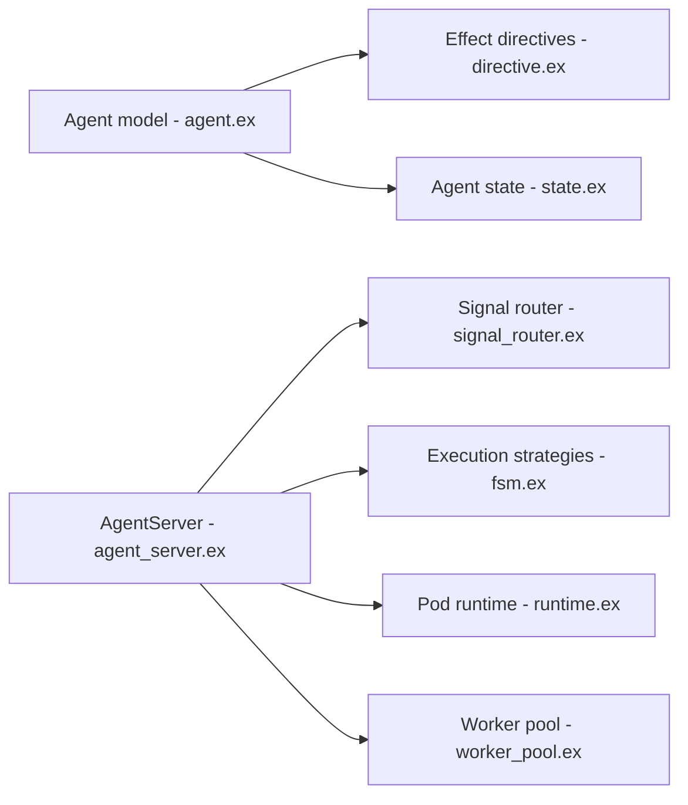

# agentjido/jido

> An autonomous-agent framework for Elixir/OTP, designed for workflows and multi-agent systems.

## The problem
Building several cooperating agents on raw GenServer forces you to reinvent messages, effects and process hierarchies.

## What it actually does
An agent is an immutable structure with `cmd/2`: actions go in, the updated agent and directives come out. Actions transform state, signals (CloudEvents) carry events, directives describe the effects that the runtime executes. `AgentServer` (GenServer) provides parent-child hierarchies, scheduling, plugins, strategies (Direct, FSM), sensors, worker pools and "pods". AI is optional through `jido_ai` and `req_llm`.

## How it is wired


## Trying it
```bash
mix igniter.install jido
mix igniter.install jido --example
mix test
mix quality
```

## Cost and gotchas
Free. Elixir 1.17+ and Erlang/OTP 26+. AI requires companion packages and a model provider key at your expense. Young repository (created in December 2024), version 2.0.

## What it is not
Not a "better GenServer": a formalized pattern on top. Not a Python framework: limited to the BEAM ecosystem.

## Alternatives
LangChain (chain-based orchestration, Python) and CrewAI (role-based agents), cited in the FAQ.

## For you
Worth watching: interesting if you build fault-tolerant agents in Elixir; otherwise your Python stack remains richer.
