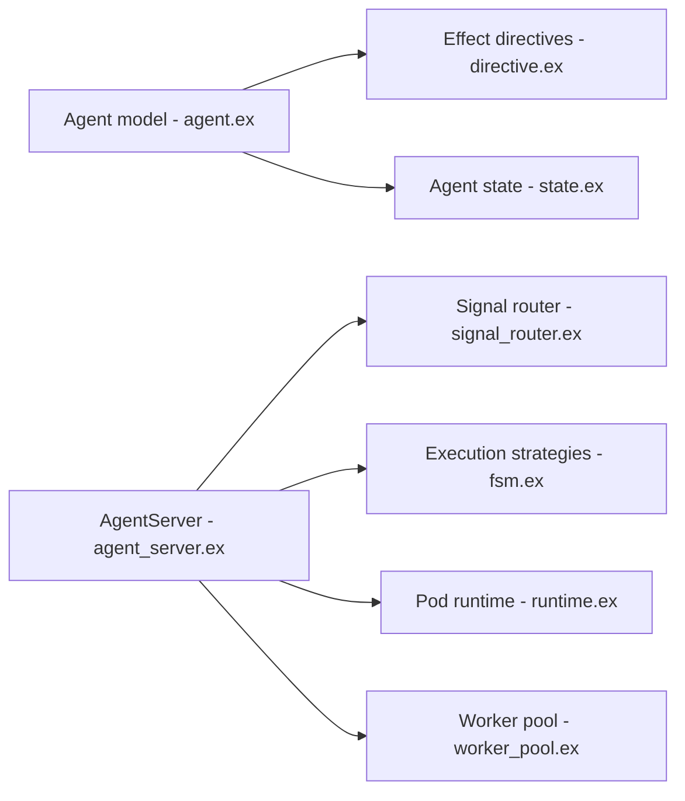

# agentjido/jido

> Framework d'agents autonomes pour Elixir/OTP, pensé pour workflows et systèmes multi-agents.

## Le problème
Construire plusieurs agents coopérants sur GenServer brut oblige à réinventer messages, effets et hiérarchies de processus.

## Ce que ça fait vraiment
Un agent est une structure immuable avec `cmd/2` : actions en entrée, agent mis à jour et directives en sortie. Les actions transforment l'état, les signaux (CloudEvents) acheminent les événements, les directives décrivent les effets que le runtime exécute. `AgentServer` (GenServer) fournit hiérarchies parent-enfant, planification, plugins, stratégies (Direct, FSM), capteurs, pools de workers et « pods ». L'IA est optionnelle via `jido_ai` et `req_llm`.

## Comment c'est branché


## Essayer
```bash
mix igniter.install jido
mix igniter.install jido --example
mix test
mix quality
```

## Coût et pièges
Gratuit. Elixir 1.17+ et Erlang/OTP 26+. L'IA exige des paquets compagnons et une clé de fournisseur de modèle à ta charge. Dépôt jeune (créé en décembre 2024), version 2.0.

## Ce que ce n'est pas
Pas un « meilleur GenServer » : un patron formalisé par-dessus. Pas un framework Python : réservé à l'écosystème BEAM.

## Alternatives
LangChain (orchestration en chaînes, Python) et CrewAI (agents à rôles), cités dans la FAQ.

## Pour toi
Surveiller : intéressant si tu bâtis des agents tolérants aux pannes en Elixir ; sinon ton stack Python reste plus fourni.

