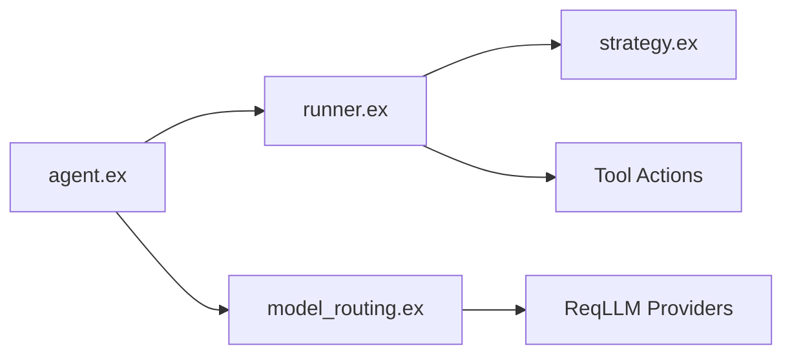

# agentjido/jido_ai

> AI runtime layer of the Jido ecosystem for writing tool-calling agents in Elixir.

## The problem
Building tool-using agents in Elixir with explicit reasoning, model routing and request tracking.

## What it actually does
Tools defined as `Jido.Action` modules, `Jido.AI.Agent` agents (ReAct by default) with `ask`/`await`, eight strategies (CoD, CoT, AoT, ToT, GoT, TRM, Adaptive), model aliases via `req_llm` (Anthropic, OpenAI, Google...), per-request controls, quotas, telemetry, CLI. The README mentions `2.0.0-rc.0`.

## How it is wired


## Trying it
```bash
mix igniter.install jido_ai
mix deps.get
mix run examples/scripts/demo/actions_llm_runtime_demo.exs
```

## Cost and gotchas
At least one provider key (Anthropic, OpenAI...); tokens at your expense. Release candidate version.

## What it is not
Not a Python framework: reserved for the Elixir/OTP ecosystem.

## Alternatives
No alternative named; depends on jido, jido_action and req_llm.

## For you
Watch: interesting if you build agents in Elixir, but in rc and of no interest if your code is in Python.
