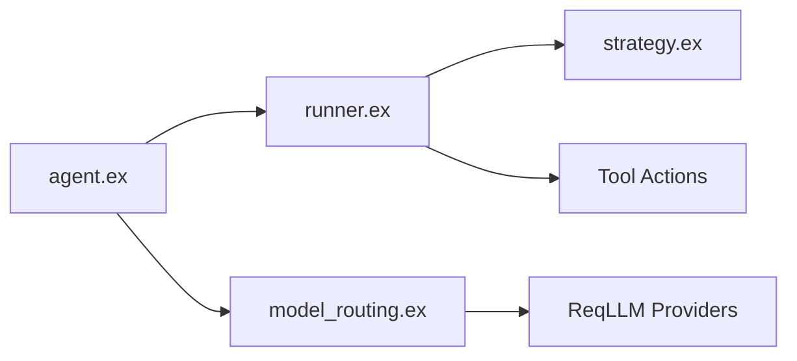

# agentjido/jido_ai

> Couche runtime IA de l'écosystème Jido pour écrire en Elixir des agents appelant des outils.

## Le problème
Construire des agents à outils avec raisonnement explicite, routage de modèles et suivi des requêtes, en Elixir.

## Ce que ça fait vraiment
Outils définis comme modules `Jido.Action`, agents `Jido.AI.Agent` (ReAct par défaut) avec `ask`/`await`, huit stratégies (CoD, CoT, AoT, ToT, GoT, TRM, Adaptive), alias de modèles via `req_llm` (Anthropic, OpenAI, Google…), contrôles par requête, quotas, télémétrie, CLI. Le README parle de `2.0.0-rc.0`.

## Comment c'est branché


## Essayer
```bash
mix igniter.install jido_ai
mix deps.get
mix run examples/scripts/demo/actions_llm_runtime_demo.exs
```

## Coût et pièges
Au moins une clé de fournisseur (Anthropic, OpenAI…) ; tokens à ta charge. Version release candidate.

## Ce que ce n'est pas
Pas un framework Python : réservé à l'écosystème Elixir/OTP.

## Alternatives
Aucune alternative nommée ; dépend de jido, jido_action et req_llm.

## Pour toi
À surveiller : intéressant si tu fais des agents en Elixir, mais en rc et sans intérêt si ton code est en Python.

