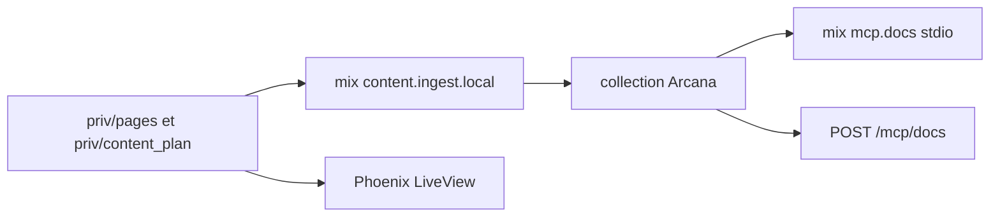

# agentjido/jido_run

> Phoenix LiveView application that serves the documentation, examples and an MCP server of the Jido site.

## The problem
A single site is needed for the documentation and examples of the Jido ecosystem, also queryable by agents.

## What it actually does
Serves the jido.run site (deployed on Fly.io) with docs pages, blog, examples and ecosystem sheets. A read-only MCP server exposes `search_docs`, `get_doc` and `list_sections`, backed by an Arcana index with a fallback to lexical search. The README states that this is not the repository of the `jido` SDK.

## How it is wired
Simplified diagram based on the sheet, no diagram provided.



## Trying it
```bash
git clone git@github.com:agentjido/agentjido_xyz.git
cd agentjido_xyz
cp .env.example .env
mix setup
mix phx.server
```

## Cost and gotchas
Requires Elixir, Erlang and a local PostgreSQL. No open sign-up: you must create an admin account through a seed.

## What it is not
Not the Jido SDK nor its public source: it is the documentation site. It is not meant to be reused as a product.

## Alternatives
No alternative named in the README.

## For you
Ignore: it is the internal site of an Elixir agent framework, useful only as an example of a docs MCP server.
