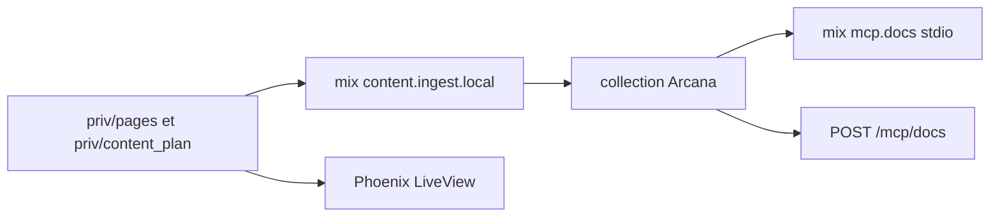

# agentjido/jido_run

> Application Phoenix LiveView qui sert la documentation, les exemples et un serveur MCP du site Jido.

## Le problème
Il faut un site unique pour la documentation et les exemples de l'écosystème Jido, interrogeable aussi par des agents.

## Ce que ça fait vraiment
Sert le site jido.run (déployé sur Fly.io) avec pages de docs, blog, exemples et fiches d'écosystème. Un serveur MCP en lecture seule expose `search_docs`, `get_doc` et `list_sections`, appuyé sur un index Arcana avec repli sur une recherche lexicale. Le README précise que ce n'est pas le dépôt du SDK `jido`.

## Comment c'est branché
Schéma simplifié d'après la fiche, sans diagramme fourni.



## Essayer
```bash
git clone git@github.com:agentjido/agentjido_xyz.git
cd agentjido_xyz
cp .env.example .env
mix setup
mix phx.server
```

## Coût et pièges
Demande Elixir, Erlang et un PostgreSQL local. Pas d'inscription libre : il faut créer un compte admin par seed.

## Ce que ce n'est pas
Pas le SDK Jido ni sa source publique : c'est le site de documentation. Il n'a pas vocation à être réutilisé comme produit.

## Alternatives
Aucune alternative nommée dans le README.

## Pour toi
À ignorer : c'est le site interne d'un framework d'agents Elixir, utile uniquement comme exemple de serveur MCP de docs.

