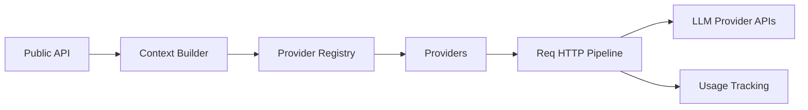

# agentjido/req_llm

> Elixir library that unifies calls to the LLM APIs of dozens of providers, for Elixir developers.

## The problem
Each LLM provider has its own request, streaming and cost formats; switching between them costs code.

## What it actually does
High-level API (`generate_text`, `stream_text`, `generate_object`, images, video, embeddings, rerank) on top of Req and Finch. Dedicated modules for around thirty providers (Anthropic, OpenAI, Bedrock, Ollama…), structured outputs, tools, usage and cost tracking, telemetry and OpenTelemetry, application-defined model routers.

## How it is wired


## Trying it
```bash
mix igniter.install req_llm
```
```bash
mix deps.get
mix test
mix quality
```

## Cost and gotchas
Provider keys and the bill remain your responsibility. Versions 1.9.0 to 1.28.0 did not verify TLS on some WebSocket sessions (GHSA-6vww-5m28-f26v): use 1.29.0 or later.

## What it is not
Not an agent framework. The displayed cost is an estimate, not a billing guarantee. Limited to the Elixir ecosystem.

## Alternatives
No alternative named (inspired by the Vercel AI SDK).

## For you
Adopt if you do Elixir: broad coverage and cost tracking; otherwise irrelevant. Apache-2.0.
