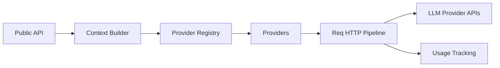

# agentjido/req_llm

> Bibliothèque Elixir qui unifie les appels aux API de LLM de dizaines de fournisseurs, pour développeurs Elixir.

## Le problème
Chaque fournisseur de LLM a ses formats de requête, de streaming et de coût ; les changer coûte du code.

## Ce que ça fait vraiment
API de haut niveau (`generate_text`, `stream_text`, `generate_object`, images, vidéo, embeddings, rerank) au-dessus de Req et Finch. Modules dédiés pour une trentaine de fournisseurs (Anthropic, OpenAI, Bedrock, Ollama…), sorties structurées, outils, suivi d'usage et de coût, télémétrie et OpenTelemetry, routeurs de modèles définis par l'application.

## Comment c'est branché


## Essayer
```bash
mix igniter.install req_llm
```
```bash
mix deps.get
mix test
mix quality
```

## Coût et pièges
Les clés fournisseurs et la facture restent à ta charge. Les versions 1.9.0 à 1.28.0 ne vérifiaient pas le TLS sur certaines sessions WebSocket (GHSA-6vww-5m28-f26v) : utiliser 1.29.0 ou plus.

## Ce que ce n'est pas
Pas un framework d'agent. Le coût affiché est une estimation, pas une garantie de facturation. Réservé à l'écosystème Elixir.

## Alternatives
Aucune alternative nommée (inspiré du Vercel AI SDK).

## Pour toi
Adopter si tu fais de l'Elixir : couverture large et suivi de coût ; sinon sans objet. Apache-2.0.

