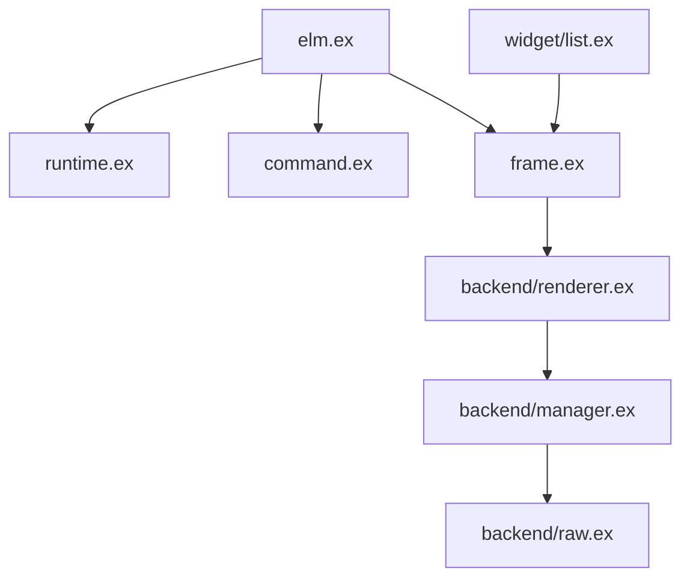

# agentjido/term_ui

> Elixir terminal runtime with an Elm architecture, used by Jido Console; same repository as pcharbon70/term_ui.

## The problem
Building a robust terminal interface on the BEAM requires a clear architecture and reusable widgets.

## What it actually does
The runtime drives the Elm application, which produces a Frame composed of pure widgets. A backend (raw with C NIF, SSH, web) displays the frame and sends events back. README identical to that of pcharbon70/term_ui.

## How it is wired


## Trying it
```bash
# mix.exs : {:term_ui, "~> 2.0.0-rc.1"}
# TermUI.run(Counter)
mix docs
```

## Cost and gotchas
Free. Elixir 1.18.4 and OTP 28 minimum; version 2.0 in release candidate. Same stars and dates as pcharbon70/term_ui: probable duplicate.

## What it is not
Not dependent on Jido, according to the README. Not a final version.

## Alternatives
No alternative named in the README.

## For you
Worth watching: same opinion as pcharbon70/term_ui, to be followed only once.
