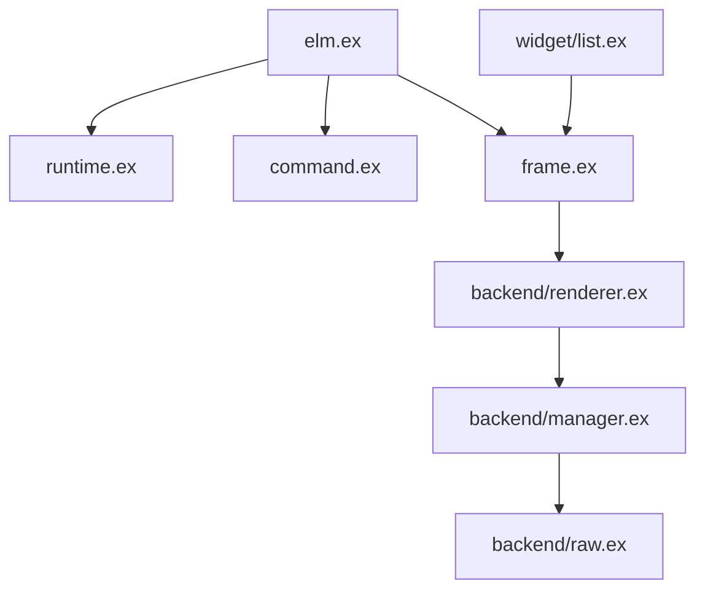

# agentjido/term_ui

> Runtime de terminal Elixir à architecture Elm, utilisé par Jido Console ; même dépôt que pcharbon70/term_ui.

## Le problème
Construire une interface de terminal robuste sur la BEAM demande une architecture claire et des widgets réutilisables.

## Ce que ça fait vraiment
Le runtime pilote l'application Elm, qui produit une Frame composée de widgets purs. Un backend (raw avec NIF C, SSH, web) affiche la frame et renvoie les événements. README identique à celui de pcharbon70/term_ui.

## Comment c'est branché


## Essayer
```bash
# mix.exs : {:term_ui, "~> 2.0.0-rc.1"}
# TermUI.run(Counter)
mix docs
```

## Coût et pièges
Gratuit. Elixir 1.18.4 et OTP 28 minimum ; version 2.0 en release candidate. Mêmes étoiles et dates que pcharbon70/term_ui : doublon probable.

## Ce que ce n'est pas
Pas dépendant de Jido, selon le README. Pas une version finale.

## Alternatives
Aucune alternative nommée dans le README.

## Pour toi
À surveiller : même avis que pcharbon70/term_ui, à ne suivre qu'une fois.

