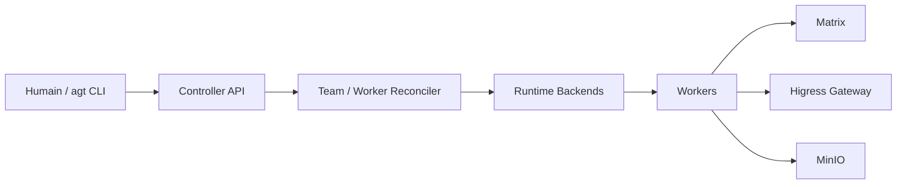

# agentscope-ai/AgentTeams

> Manager-Workers platform that makes several agents collaborate in Matrix rooms that humans can see and steer.

## The problem
Getting several agents to work as a team without each of them holding the real API keys, and without a black box between them.

## What it actually does
A Kubernetes controller reconciles Manager, Team, Worker and Human resources. Each agent (OpenClaw, QwenPaw, Hermes, experimental DeepSeek Harness) runs in its own container. They talk in Matrix rooms (Tuwunel + Element Web), share files via MinIO, and go through the Higress gateway, which keeps the real credentials: Workers only hold a consumer token.

## How it is wired


## Trying it
```bash
bash <(curl -sSL https://raw.githubusercontent.com/agentscope-ai/AgentTeams/main/install/agentteams-install.sh)
```
Then open http://127.0.0.1:18088 (Element Web). Kubernetes alternative: `helm install agentteams higress.io/agentteams -n agentteams-system --create-namespace ...` with `credentials.llmApiKey`.

## Cost and gotchas
LLM API key at your expense; minimum 2 CPUs and 4 GB of RAM, 4 cores and 8 GB for several Workers. Images point to a Chinese registry by default. The installer uses `curl | bash`.

## What it is not
Not an agent runtime: it orchestrates existing agent containers. The Manager is only compatible with OpenClaw or QwenPaw; DeepSeek Harness is experimental. About 250 open issues.

## Alternatives
- Native OpenClaw: a single process, simpler but each agent holds its own keys.

## For you
Worth watching: the idea of consumer tokens behind a gateway is useful for an MLOps engineer deploying agents as a team, but the stack (Matrix, Higress, MinIO, K8s) is heavy for a simple test.
