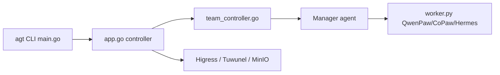

# agentscope-ai/HiClaw

> Manager–Workers multi-agent runtime where humans and agents collaborate in visible Matrix rooms.

## The problem
Getting several agents to cooperate without losing human visibility, and without letting each agent hold real API keys.

## What it actually does
A Manager creates and drives Workers (OpenClaw, QwenPaw, Hermes, experimental DeepSeek Harness) in Matrix rooms (Tuwunel + Element Web). A Higress gateway holds the real credentials: Workers only have consumer tokens. MinIO provides shared storage. A Docker installer, or a Helm chart for Kubernetes (controller, Worker/Team/Human CRDs). The README presents itself under the name "AgentTeams".

## How it is wired


## Trying it
```bash
bash <(curl -sSL https://raw.githubusercontent.com/agentscope-ai/AgentTeams/main/install/agentteams-install.sh)
```
Then open http://127.0.0.1:18088.

## Cost and gotchas
LLM API key at your expense; 2 CPUs and 4 GB of RAM minimum. The README installs via `curl | bash`. Images point to a Chinese registry by default.

## What it is not
Not an agent framework: it orchestrates existing agent containers. The DeepSeek Harness runtime is experimental.

## Alternatives
- Native OpenClaw: compared in the README table (a single process, keys held by each agent).

## For you
Worth watching: the idea of isolated keys behind a gateway is interesting for production agents, but the project is young and tightly tied to the agentscope ecosystem.
